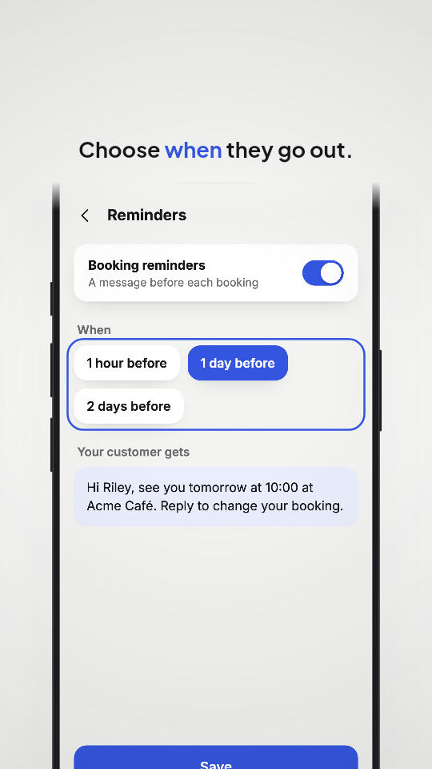
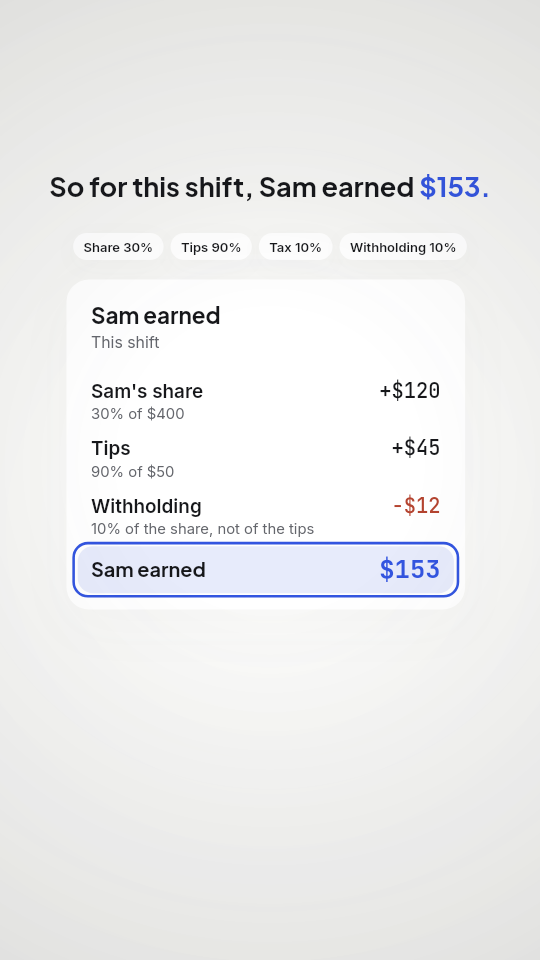
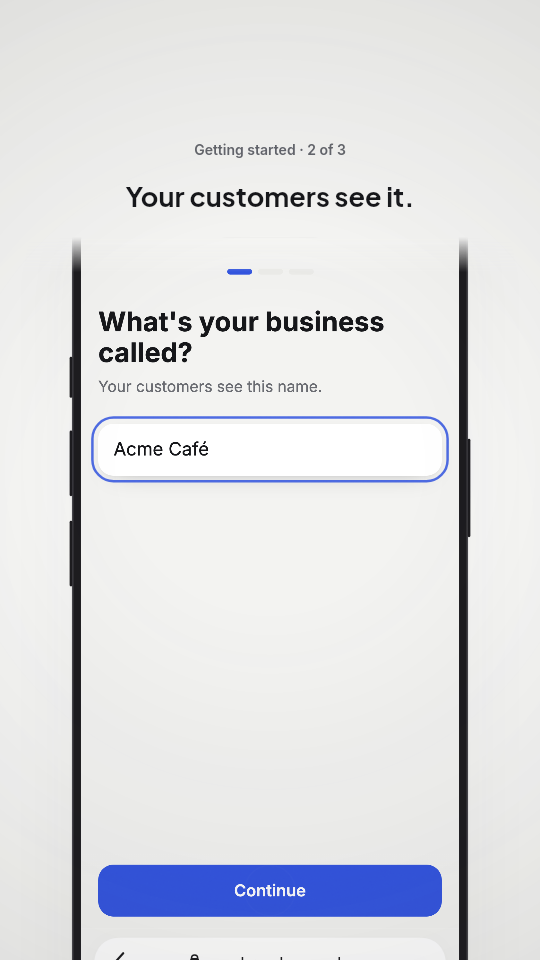
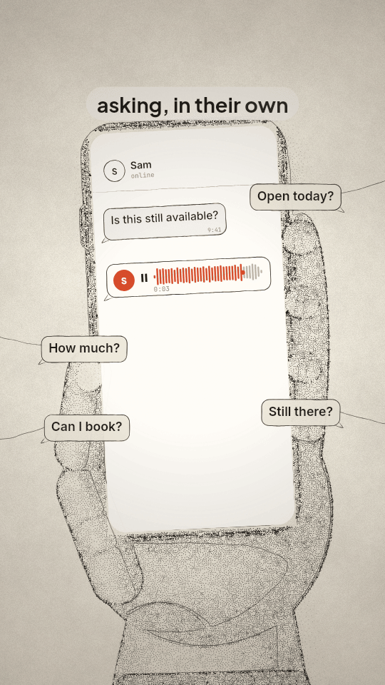
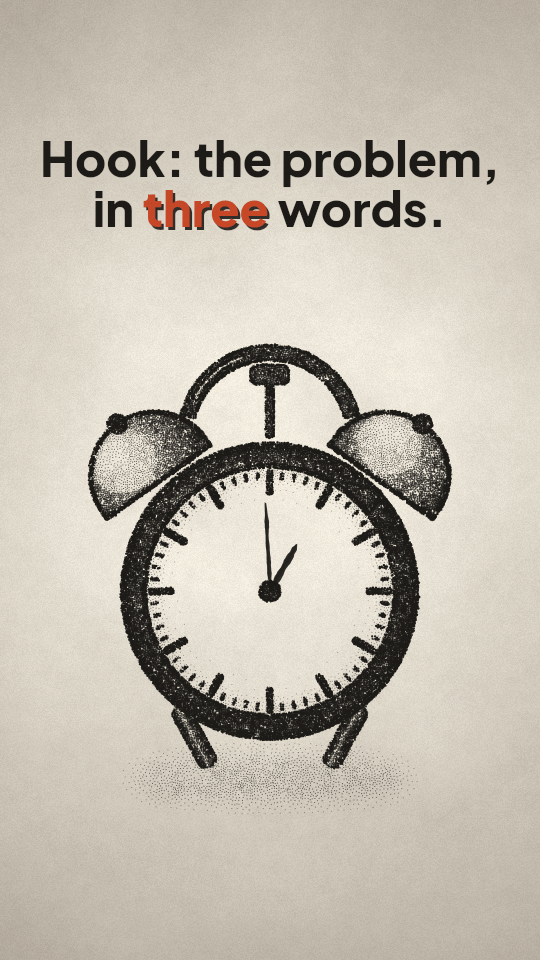
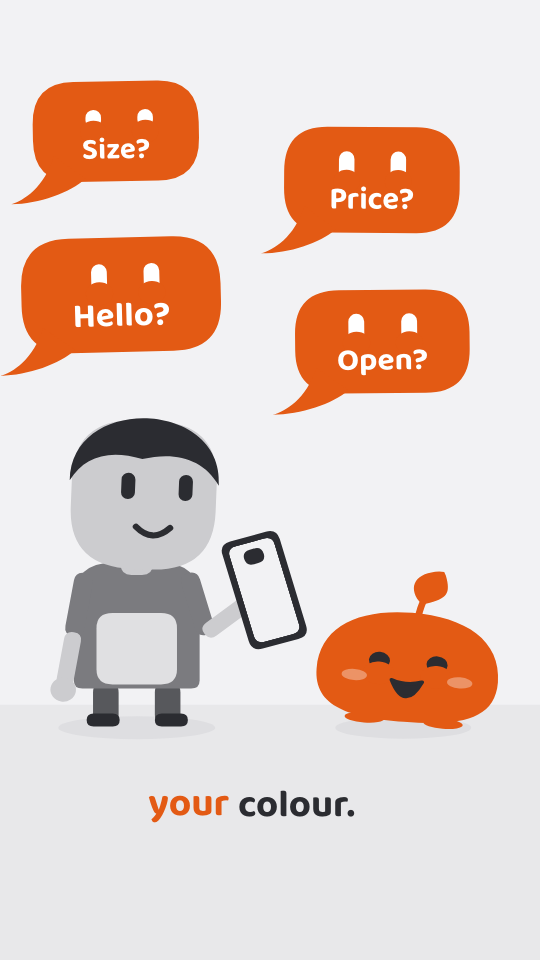
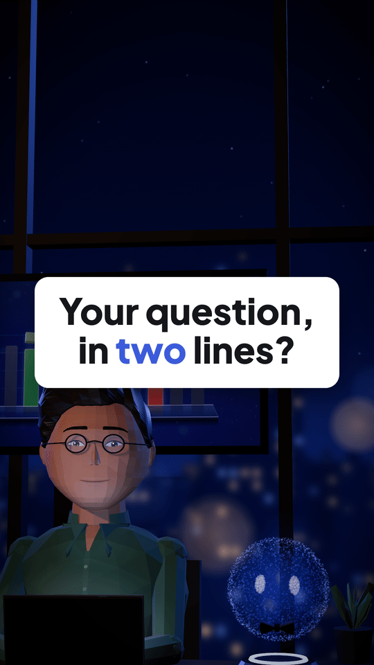
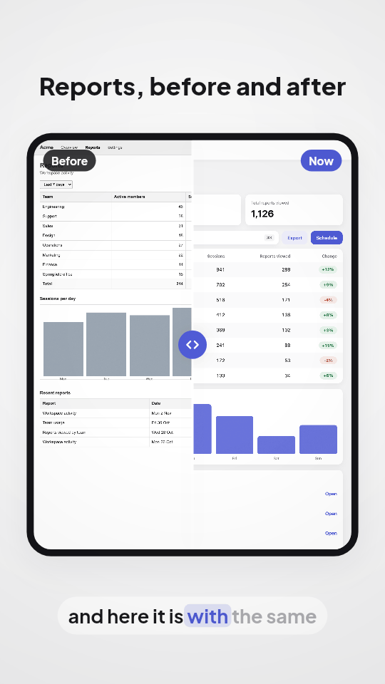
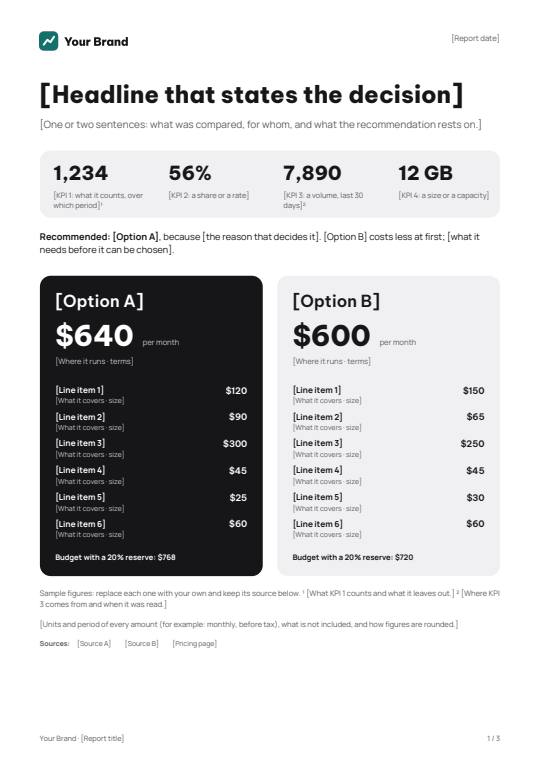

# arn-video-workbench

A workbench for making videos in code. Each bench recreates one video style end to end: script → voices → word-timed timeline → animation → music and effects → mix → render → delivery checks. Each one ships with a generic sample you can render and then replace with your own brand, logo, colours, fonts, voices and characters.

Everything is deterministic and runs headless. A new voice take re-times the whole film, because every visual cue is anchored to a word.

## Benches

| Bench | What it makes | Look |
|---|---|---|
| [`app-tutorial`](benches/app-tutorial/) | A feature tutorial on real screenshots of your app. The camera pushes in on each control as the voice names it, with taps and word-synced captions. |  |
| [`calculation-explainer`](benches/calculation-explainer/) | How an amount is calculated: ledger cards that count up in the order of the narration, then the app screen with the same numbers. Canvas or HTML. |  |
| [`story-highlights`](benches/story-highlights/) | Packs of 2–3 stories for profile highlights that join seamlessly, plus covers and a joined reel. |  |
| [`particle-film`](benches/particle-film/) | A narrative brand film of stippled particles and pencil strokes, where objects transform and the dots end as your logo. 60 fps. |  |
| [`micro-ad-series`](benches/micro-ad-series/) | Many 6–25 s single-message ads from one workshop, driven by an ideas catalogue and a claims linter. |  |
| [`cartoon-ads`](benches/cartoon-ads/) | Flat SVG cartoons: a grey world, one accent-coloured mascot, people and props acting out a problem, a particle layer and a logo end card. |  |
| [`two-character-studio`](benches/two-character-studio/) | A 3D dialogue between a human host and an AI particle orb in a night office, with evidence on the wall TV. HDR master. |  |
| [`progress-report-video`](benches/progress-report-video/) | The weekly product update for partners: one real metric, before/after captures built from git commits, the big feature, and a list. 60 fps. |  |
| [`pdf-report`](benches/pdf-report/) | A branded executive PDF: a decision headline, KPIs, options compared, a scale table, footnotes and sources, with layout and read-back checks. |  |

Not sure which one fits? [`docs/production.md`](docs/production.md) maps scene needs to benches.

## Requirements

- Node.js 20+, Python 3.11+, FFmpeg 6+ (with `libx264`; `libx265` for the HDR master), Git.
- Headless Chromium through Playwright: `npx playwright install --only-shell chromium` (the headless shell is all the benches use).
- Optional voice and music providers: ElevenLabs, OpenAI, a local CosyVoice 3, or macOS `say`. Keys go in `.env` (see [`.env.example`](.env.example)). Without any key, the `silent` provider still lets every sample render.
- Optional for `two-character-studio`: [Rubber Band](https://breakfastquay.com/rubberband/) (pitch with formants for the orb's voice) and [ExifTool](https://exiftool.org) (the Apple frame-rate tag on the HDR master).

## Quick start

```sh
git clone https://github.com/YosephFr/arn-video-workbench && cd arn-video-workbench
python3 -m venv .venv && .venv/bin/pip install -r core/requirements.txt
(cd core/node && npm install && npx playwright install --only-shell chromium)
cp .env.example .env                       # optional: keys and voice ids

# render the calculation explainer sample with placeholder voices
(cd benches/app-tutorial && npm install)   # the tutorial kit and the capture tool it builds on
(cd benches/calculation-explainer && npm install)
core/bin/fetch-fonts.sh "Plus Jakarta Sans:500,600,700,800" "Inter:400,500,600,700" "JetBrains Mono:500,600,700"
P=benches/calculation-explainer/samples/shift-payout
node benches/app-tutorial/tools/capture.mjs --flow $P/capture.json
WB_TTS_PROVIDER=silent core/bin/wb voice $P && core/bin/wb timeline $P && core/bin/wb music $P
node benches/calculation-explainer/engine/render.mjs $P events && core/bin/wb mix $P
node benches/calculation-explainer/engine/render.mjs $P preview
core/bin/wb verify $P/renders/preview.mp4 --size 540x960
```

`core/bin/wb` loads `.env` by itself; a variable already set in your shell wins, and empty values are skipped. The bench engines and tools read only the shell environment, so when they need a key, load it first: `set -a; . ./.env; set +a`.

Every bench README has its own exact commands, a production flow, a review checklist and the lessons learned.

## Make it yours

1. **Start a piece**: `core/bin/wb new <bench> <name>` copies the bench's sample into `work/<bench>/<name>`.
2. **Rebrand**: edit `brand/brand.json` (name, colours, fonts, logo, radius) or drop a `brand.json` in the piece. Fonts are fetched from Google Fonts with `core/bin/fetch-fonts.sh`. Logos are your own SVGs.
3. **Write** `script.json`: short lines, `*emphasis*` for captions, `[direction]` hints for the voice. See [`docs/CONTRACT.md`](docs/CONTRACT.md).
4. **Voices**: pick a provider per voice. For a local voice with no API, install CosyVoice (`core/bin/install-cosyvoice.sh`) and point a voice at a 10–15 s clip of someone who agreed to lend it. A synthetic voice made with a provider's voice-design tool also works, under that provider's terms. Never clone a voice without permission.
5. **Animate** in the bench's `film.js` (or `scenes.html`), anchoring every cue to a line or word from `timeline.json`.
6. **Review** stills one by one, then the preview with sound, then render and `wb verify` the final.

## Layout

```
core/            shared tools: voices, timeline, music, effects, mix, verify, HTML frame capture, fonts, CosyVoice installer
benches/<style>/ one folder per style: engine, tools, brand, samples, README, poster
docs/            CONTRACT.md (file formats), production.md, visual-review.md, references.md
```

## For agents

Read [`AGENTS.md`](AGENTS.md) first. It covers how to choose a bench, the order of work, what to check before calling a video done, and the content rules.

## License

[MIT](LICENSE). The fonts, models and libraries that the tools download keep their own licenses (OFL, Apache-2.0, MIT, BSD). See [`docs/references.md`](docs/references.md).
