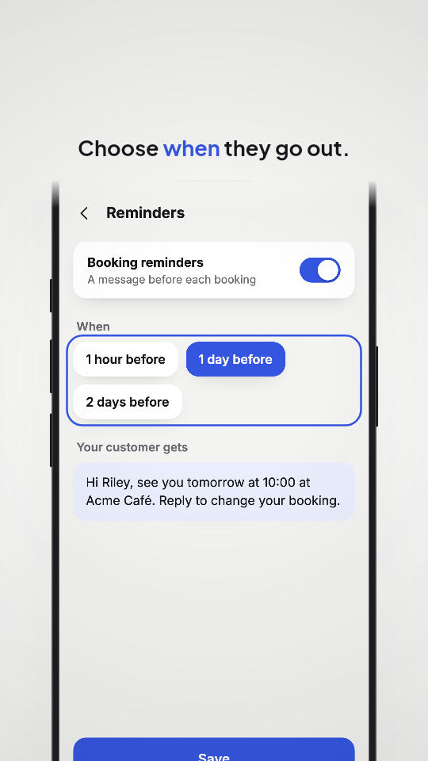

# App tutorial

A feature tutorial on real screenshots of your app. The phone stays whole on screen; the camera pushes in on each control as the voice names it, a finger taps on the action word, captions follow the voice word by word, and the brand closes. Vertical 1080 × 1920 at 30 fps, laid out for the overlays of Reels, Shorts, TikTok and Stories.



This bench also holds the **tutorial kit** (`engine/kit/`) and the **capture tool** (`tools/capture.mjs`) that `calculation-explainer` and `story-highlights` build on.

## When to use it

- Teaching one feature: where it lives and the three to six taps that use it. Settings, onboarding steps, a new screen.
- Showing what the other side sees: the message a customer gets, the screen a teammate opens.
- Not for explaining how a number is calculated (use `calculation-explainer`), for a series of short stories that form a highlight (`story-highlights`) or for selling a feeling (`particle-film`).

## The recipe

### Structure

1. **Hook, first 2 seconds.** What the viewer gets from the feature, in one sentence, over a real screen. The first frame already shows the app.
2. **Steps.** One action per line, then a short pause: viewers cannot scroll back. Name every button exactly as the screen writes it.
3. **The other side.** When the voice talks about the customer or the teammate, the phone changes owner: the label above it changes ("Your customer's phone") and the screen is theirs (a capture, or a screen drawn in code).
4. **Result.** What is now true, in plain words. Claim only what the product does today.
5. **Brand close.** Your name and one short line, spoken over the end card.

20 to 60 seconds. Pauses of 0.45–0.5 s between lines, 0.7 s before the brand close.

### Picture

| Element | Rule |
|---|---|
| Phone | Centred, top at y 548, screen 556 px wide (a 393-px-wide device at 1.415×). Body, side buttons, camera island, status bar and home indicator are drawn in code; the screen is a 3× capture. `frame: 'android'` gives a punch-hole phone. `mode: 'browser'` adds a compact address bar for web apps. |
| Camera | `focus(capture, element, { t, until, z })` brings a measured element to (540, 900) and zooms around it. z 1.3–1.6 keeps app text readable on a phone; the kit caps it so the element fits between the platforms' buttons. Moves take 0.35–0.6 s (in-out cubic). Push in on the word, hold, come back. |
| Rest | While the camera rests, the phone drifts in by 0.4% a second (3% at most); the next move takes the drift back out. A frame that does not move for a second reads as stopped. |
| Transitions | `push` a new page, `back` returning, `sheet` and `unsheet` for bottom sheets, `fade` for a tab switch, `cut` for a new state of the same screen (pressed, typed, toggled). Use the transition the app itself plays. Between two captures of a web app (`mode: 'browser'`) only the page slides on `push` and `back`: the status strip and the address bar stay in place. |
| Tap | A soft disc presses in 0.4 s before the tap and a ripple spreads after it. It fades with the transition it causes and, after a cut, follows the same button. Tap on the action word. |
| Ring | Draws itself around the element in 0.45 s, accent colour, 5 px, with the element's own radius. `kind: 'spot'` dims the rest of the screen instead. |
| Loupe | Lifts an element's pixels into a larger card when you need the detail without leaving the full screen. |
| Label | Above the phone, whose screen it is ("Your app"). It leaves while the camera is pushed in. |
| Captions | Display font, 700, 54 px, ink, centred at y 372, two rows at most and nine words per chunk. Each word fades and rises in on its own timestamp; `*emphasis*` takes the accent. When the phone rises behind them, the background covers the top again so they read clean. Spoken numbers become figures with `captions.replace`. |
| End card | The background covers the frame, the mark pops in and lands with a ripple, slides into the horizontal lockup while the name wipes in, then one line and the address. It keeps a slow push while it holds. |
| Finish | Light film grain (2.2%, changing 12 times a second) and a soft vignette. |
| Colour and type | Background `brand.colors.background` with a soft light centre; accent only for emphasis, rings and the address. Normal case, no letter-spacing, no decorative tags. |

### Safe zones

What the platforms cover on a 1080 × 1920 organic post, and what ads or a long caption cover as well:

| Zone | Covered | Risk |
|---|---|---|
| Top | y 0–200 (account, header) | y 200–270 (ad header) |
| Right | x 940–1080, y 820–1720 (buttons) | |
| Bottom | y 1440–1920 (name, caption, audio) | y 1248–1440 (long caption, ad) |

Captions, rings, taps, labels and loupes stay out of both. Buttons at the bottom of an app (Save, Continue) fall under the platform's caption: push the camera in on them before the tap. `render.mjs <piece> check --social` finds anything that lands in a zone, and `WB_GUIDES=social` draws the zones on stills. Re-check the overlays of the network you publish on: they change.

## Audio

- **Voice.** One brand voice, friendly and direct, at full voice. No characters, no acting out scenes. Direction tags that work: `[clear, full voice]`, `[confident, full voice]`, `[explaining]`, `[upbeat, not over the top]`. Tags that lower the voice (whispering, softly, intimate, smiling) come out whispered: the linter rejects them. Tempo 1.0–1.05. Cast by ear with a real line from the script; transcribe every take and reject takes that change or swallow a word.
- **Music.** `style: "tutorial"`, 100–108 BPM, warm and light with a steady beat; no vocals, hi-hats, cymbals or drops. `level: -22`, `duck: -6`: about 11 dB under the voice, audible like a commercial, never covering a word.
- **Effects.** `tap` on taps (−20 dB), `whoosh` on page changes (−28 to −30 dB), `ding` or `pop` on confirmations (−24 to −28 dB), `whoosh` and `logo` on the end card (added by the kit). Keep effects off key words.
- **Loudness.** −14 LUFS integrated, true peak at or under −1 dBTP after AAC encoding (`core/bin/wb mix` and `wb verify`).

## Format

1080 × 1920, 30 fps, H.264 yuv420p BT.709, AAC 256 kb/s 48 kHz. Preview at 540 × 960. Master at CRF 20 with a 14 Mb/s ceiling.

## Production flow

From the repository root.

```sh
# once
(cd benches/app-tutorial && npm install)
core/bin/fetch-fonts.sh "Plus Jakarta Sans:500,600,700,800" "Inter:400,500,600,700" "JetBrains Mono:500,600,700"

# the sample, end to end, without paying for anything
node benches/app-tutorial/tools/capture.mjs --flow benches/app-tutorial/samples/feature-tour/capture.json
WB_TTS_PROVIDER=silent core/bin/wb voice benches/app-tutorial/samples/feature-tour
core/bin/wb timeline benches/app-tutorial/samples/feature-tour
node benches/app-tutorial/engine/render.mjs benches/app-tutorial/samples/feature-tour still 1,5,9,13,17,21
```

A new tutorial:

1. **Start a piece.** `core/bin/wb new app-tutorial my-feature` copies the sample to `work/app-tutorial/my-feature`.
2. **Capture your app with demo data.** Write the flow in `capture.json` (below) and run `node benches/app-tutorial/tools/capture.mjs --flow work/app-tutorial/my-feature/capture.json`. One screen at a time also works: `node benches/app-tutorial/tools/capture.mjs --url http://localhost:5173/settings --name settings --out work/app-tutorial/my-feature/captures/app --measure save=#save`.
3. **Write the script** in `script.json`, one step per line, then `python3 benches/app-tutorial/tools/lint_script.py work/app-tutorial/my-feature`.
4. **Voice and timeline.** `core/bin/wb voice <piece> --takes 2`, listen, keep the best take of each line in `voice/selection.json`, then `core/bin/wb timeline <piece>`. With `WB_TTS_PROVIDER=silent` you can block out the whole film before recording.
5. **Film.** Edit `film.js`, then `node benches/app-tutorial/engine/render.mjs <piece> check --social` and stills: `... still 2,6,10`, `WB_GUIDES=social ... still 6`, and `... review` (one still per screen, ring and tap, listed in `renders/review/moments.txt`). Look at them one by one, in order.
6. **Audio.** `core/bin/wb music <piece>`, `node benches/app-tutorial/engine/render.mjs <piece> events` (taps, transitions and the end card become `events.json`), `core/bin/wb sfx <piece>`, `core/bin/wb mix <piece>`.
7. **Preview with sound.** `... preview`, watched whole at phone size.
8. **Final and checks.** `... final`, then `core/bin/wb verify <piece>/renders/final.mp4`.
9. **Grid cover.** `WB_COVER='Title|Subtitle' node benches/app-tutorial/engine/render.mjs <piece> still 6 --scale 1` writes a frame with a title band inside the 3:4 crop profiles show.

All render modes: `still t1,t2` · `sheet a:b:step` · `preview [--to 8] [--silent]` · `final` · `poster t` (540 × 960, ≤ 400 KB) · `events` · `check [--social]` (also lists every missing capture and the command that makes it) · `review` · `info`.

## film.js

A film is a function of the film API that returns a configuration. It never hard-codes seconds: every time comes from a line or a word of the timeline, so a new recording re-times the film.

```js
module.exports = ({ W, L, focus }) => {
  const w = (id, word, n = 0) => W(id, word, n).start;   // the n-th word of a line that starts with `word`
  const tTap = w('L02', 'Settings');
  return {
    shots: [{ at: 0, cap: 'flow/01-home', chip: 'Your app' }, { at: tTap + 0.25, cap: 'flow/03-settings', trans: 'fade', dur: 0.25 }],
    phone: [{ t: 0 }, focus('flow/01-home', '@settings', { t: tTap - 0.4, until: tTap + 0.3, z: 1.5, y: 1080 })],
    marks: [{ at: tTap - 0.4, to: tTap, el: '@settings', shot: 0 }],
    taps: [{ at: tTap, el: '@settings', shot: 0 }],
  };
};
```

**API:** `W(id, word, n)`, `L(id)`, `Wi(id, i)` (timeline) · `T.duration`, `T.lastEnd` · `focus(cap, el, o)` · `rect(cap, el)`, `union(...rects)`, `pad(rect, d)`, `scrollOf(cap)` (boxes from measured elements) · `seq(prefix)` · `sfx(t, name, gain_db)` · `ease`, `clamp`, `lerp`, `smoothstep` · `brand`, `C` (colours), `font(weight, size, role)`, `rr` · `script`, `dir`, `reel`.

| Key | What it is |
|---|---|
| `shots` | What the phone shows, from `at` on: `cap` (a capture id), or `seq` (a typing or animation sequence, `dt` seconds per frame), or `draw(c, t, w, h, api)` (a screen drawn in device px). Options: `trans` (`none`, `cut`, `push`, `back`, `sheet`, `unsheet`, `fade`), `dur`, `sheetTop` (where the sheet starts on its capture, in capture px: only the sheet rises, and the screen behind blurs and dims into the capture's own backdrop; `sheetRadius` defaults to 24), `chip`, `mode: 'browser'` + `url`, `frame: 'android'`, `dark` (white status bar), `time`, `mask: [{ x, y, w, h, color }]` (cover a line with the page colour), `scroll: [{ t, y }]` with `fixed: [header, bottom]` and `until` (a page that scrolls under its fixed bars), `paint(c, t, dev)`. |
| `phone` | Camera keys `{ t, cx, top, sw, alpha, z, fx, fy, tx, ty, dur }`. A key arrives at `t`, moving during `dur`. `focus()` builds them from an element; `fx, fy` aim at device px directly (drawn screens). |
| `marks` | Rings `{ at, to, el, shot, kind, pad, r, color, width }`, `kind` being `'ring'` or `'spot'`. |
| `taps` | `{ at, el, shot, dx, dy, sound, gain }`. |
| `loupes` | `{ at, to, el, shot, zoom, x, y, pad }`. |
| `labels` | `{ at, to, text, el, side, x, y }`, `side` being `'above'` or `'below'`. |
| `over` | `{ at, to, draw(u), under, top, topAt }`: anything drawn outside the phone (`under` behind it, `top` above the captions). A device drawn here (a tablet, a TV) returns its top edge from `topAt(t)` as `{ top, alpha }` in frame px, so the caption band also covers it when a zoom brings it under the captions. |
| `captions` | `{ y, size, maxWords, style, skip, replace, icons }` (`style` is `'band'` or `'pill'`) or `false`. `icons` puts an image before a word: logos you are licensed to show. |
| `card` | End card `{ lock, line, url }`, or `false`. `lock` is when the lockup completes (default: 1.45 s after the last word; put it 0.9 s into the brand line so the line is spoken over the card). |
| `events` | Extra effects `{ t, name, gain_db }` for `events.json`. |
| `drift`, `post`, `band`, `time`, `chipY`, `phoneBase` | Rest drift rate (or `false`), finish (`{ grain, vignette }`), caption band on or off, status-bar time, label position, phone placement. |

**Elements** are found in the capture's measured rectangles: `'Save'` (by text: exact, then prefix, then contains; buttons and cards before loose text), `'@save'` (the element measured with the selector named `save`), `{ q: 'Total', text: true }` (prefer loose text), `{ q: 'Riley', box: true }` (the smallest card that contains the text), `{ q: 'Edit', n: 1 }` (the second match from the top), or `{ x, y, w, h }` in device px.

## Captures

`tools/capture.mjs` opens your app in headless Chromium (a throwaway profile, never a visible window) as a 393 × 852 phone at 3× (`mode: "app"`, with 59/34 px safe areas) or a 393 × 710 web page (`mode: "browser"`: the film draws the status and address bars). For each screen it writes `NN-name.png` and `NN-name.json`.

- **Deterministic.** The clock is fixed (`clock`) while timers and animations keep running (a fully paused clock can leave single-page apps blank); timezone and locale are set; the caret and scrollbars are hidden; brand fonts can be served to the page (`fonts`); it waits for three identical frames before shooting.
- **Closed.** Every request outside the app's own origin and the hosts in `allow` is blocked and listed in `manifest.json`. Point it at a local build with demo data, never at production with real customers.
- **Checked.** Text such as `undefined`, `NaN`, `null`, `Error`, `lorem ipsum`, loading skeletons and toasts are reported per capture.
- **Measured.** `elements`: every button, link, field, tab, switch, option, heading, card and list item that a finger could touch, with its text, role, rectangle and corner radius; `texts`: every run of visible text; plus the elements you name with selectors (`measure`).
- **Sequences.** `type` writes one frame every few letters at finger pace (`NN-name.type-01.png …`); `animate` keeps the distinct frames of an animation spread over time (`NN-name.anim-01.png …`); `press` captures the pressed state (finger down) before releasing.
- **Long pages.** When the page scrolls, `NN-name.full.png` is shot by growing the viewport to the document height, so fixed headers stay on top and fixed bars at the very bottom, with their own measured rectangles.

```json
{ "name": "reminders", "url": "http://localhost:5173/", "mode": "app",
  "clock": "2026-03-06T09:41:00Z", "timezone": "UTC", "locale": "en-US", "fonts": "${ROOT}/assets/fonts",
  "measure": { "save": "#save" }, "allow": ["api.localhost"],
  "steps": [
    { "goto": "#home" }, { "capture": "home", "measure": { "settings": "#tab-settings" } },
    { "press": "#tab-settings", "capture": "home-pressed" }, { "capture": "settings" },
    { "type": "#name", "text": "Alex", "every": 2, "capture": "name" },
    { "animate": "#save", "frames": 6, "ms": 900, "capture": "saving" },
    { "scroll": "#total" }, { "wait": 300 }, { "waitFor": ".loaded" } ] }
```

`${BENCH}`, `${ROOT}`, `${FLOW}` and environment variables are expanded. Captures land in `<flow folder>/captures/<name>/` (git-ignored); films refer to them as `name/NN-step`. `samples/mock-app/` is a neutral demo app, so the whole loop runs without any real product.

`NN-name.json`:

```json
{ "viewport": { "w": 393, "h": 852, "dpr": 3 }, "scroll": { "x": 0, "y": 0, "maxY": 0, "height": 852 },
  "safeArea": { "top": 59, "bottom": 34 }, "mode": "app", "url": "…", "name": "reminders", "action": "Tap #switch",
  "elements": [ { "text": "Save", "role": "button", "x": 18, "y": 752, "w": 357, "h": 54, "radius": 16, "name": "save" } ],
  "texts": [ { "text": "Your customer gets", "x": 22, "y": 374, "w": 349, "h": 19 } ],
  "full": { "file": "05-reminders.full.png", "w": 393, "h": 1400, "elements": [], "texts": [] } }
```

## Review checklist

- [ ] `check --social` is clean: every ring and tap on the visible screen, nothing in a covered zone.
- [ ] The first frame shows the app; the hook is said in the first two seconds.
- [ ] Every button the voice names is ringed or tapped on that word, and the screen does what the voice says, in that order.
- [ ] App text is readable at phone size while the camera is pushed in; nothing important sits under the caption band.
- [ ] Stills at every screen change and every tap, looked at one by one, in order: no jumps, no doubled taps, no ring left floating after a transition.
- [ ] Captions match the voice word for word; figures appear as figures; brand and product names are spelled right.
- [ ] Demo data only: no real customer, phone number, email or price you do not mean to publish; no test banners (mask them).
- [ ] The voice is full and clear in every line; music audible between sentences and never over a word.
- [ ] `wb verify` passes: resolution, frame rate, −14 LUFS, true peak ≤ −1 dBTP, no black or frozen stretch outside the end card.

## Rebrand

1. `brand/brand.json`: name, tagline, address, colours (`background`, `surface`, `ink`, `muted`, `accent`, `accent_ink`, `positive`, `negative`), fonts and logo. A piece can override it with its own `brand.json`.
2. Fonts: `core/bin/fetch-fonts.sh "Your Display:600,700,800" "Your Body:400,500,600"` or TTFs in `brand/fonts/`. The kit registers every TTF it finds under its internal family name.
3. Logo: a square mark (`brand/logo-mark.svg`, SVG or PNG with transparent corners). An optional wordmark must have outlined text (no live fonts in the SVG); without it the end card sets your name in the display font.
4. Capture your own app instead of the demo app, with your demo data, locale and timezone.
5. Labels above the phone, caption replacements and icons are per film. Any language works: the voice provider decides the accent; write numbers as words and show them as figures with `captions.replace`.

## Lessons from production

- Screens come from the real app, captured with demo data in a local build: centred, cards and buttons at their true size, nothing invented around them. Drawn screens are only for what cannot be captured (a lock screen, a third-party sheet).
- Boxes come from measured elements (`rect`, `union`, `pad`, `@name`), never from pixel positions: when the app's layout changes between versions, a new capture moves every ring with it.
- Tap on the action word, ring on the noun. The screen must do what the voice says, in the same order: a toggle that is already on when the voice says "switch it on" breaks trust.
- One action per line with a pause after it. Two actions in one sentence leave less than a second per screen.
- Bottom buttons (Continue, Save) fall under the platforms' caption: push the camera in on them before the tap.
- A ring may outlive a cut for 0.4 s (a cut right after a tap is usually the same button in its next state) and may span cuts when its element stays put (typing frames). The checker accepts both.
- A tap that opens a sheet fades with the sheet; after a cut it follows the same button. A label above the phone must follow the phone when the camera moves, or it covers the bezel.
- With the camera pushed in, the phone rises behind the captions: cover the top with the background so the caption reads.
- Typing frames are shot at finger pace and the final frame is the last typing frame, so a search with a delay does not fire. Keyboard-only variants are left out of a sequence.
- Freeze the clock but keep timers alive; block every request outside the app; hide carets and scrollbars; wait for three identical frames. Reject captures with `undefined`, `NaN`, skeletons or toasts.
- A long page scrolls under fixed header and bottom bar: the moving band comes from the full-page capture, the fixed parts from the viewport capture.
- Spoken numbers are written as words in the script (the voice reads them right) and shown as figures in the captions with `replace`.
- Voices are never whispered. Tags that soften the voice come out at lower level and pitch, and automatic judges do not hear it: measure level and pitch per line, and regenerate with the same text and voice.
- Music must be audible like in a commercial, about 10–11 dB under the voice. Check that a generated track is not silent before mixing.
- Review exported frames one by one, in order, at a readable size, with extra frames around every change. A contact sheet hides the jump between two frames, and a render that finishes without errors proves nothing about how it looks.
- A frame that does not move for a second reads as frozen on a phone: keep a slow drift while the camera rests, and a slow push on the end card.

## Files

```
benches/app-tutorial/
├── README.md
├── package.json              @napi-rs/canvas (Skia) and Playwright (captures)
├── brand/                    brand.json and a placeholder mark
├── docs/poster.png
├── engine/
│   ├── render.mjs            entry point: still, sheet, preview, final, poster, events, check, review, info
│   └── kit/                  the tutorial kit, shared with calculation-explainer and story-highlights
│       ├── tutorial.js       defineTutorial: shots, camera, taps, rings, loupes, labels, captions, end card
│       ├── captures.js       capture lookup and element queries
│       ├── device.js         phone body, status bar, address bar
│       ├── captions.js       word-synced captions
│       ├── brand.js          brand layers, fonts, colours, end-card lockup
│       ├── timeline.js       timeline.json (or an estimate from script.json)
│       ├── zones.js          platform safe zones
│       ├── check.js          film checker
│       ├── frame.js, math.js, canvas.js
│       └── render.js         stills, workers, encoding, muxing
├── tools/
│   ├── capture.mjs           the capture tool
│   ├── fonts.mjs             brand fonts for pages rendered in Chromium
│   └── lint_script.py        script checks before recording
└── samples/
    ├── feature-tour/         script.json, film.js, capture.json (an empty guiding sample)
    └── mock-app/             a neutral demo app to capture
```
