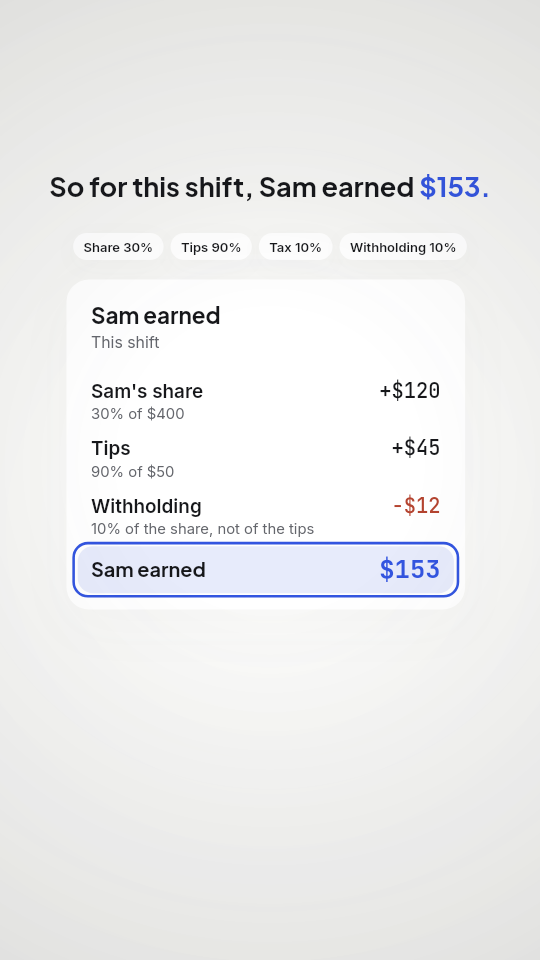

# Calculation explainer

Explains how an amount is calculated: a day's payout, a bill, a commission, a refund. Cards whose rows and amounts appear and count up in the order the voice names them, a running ledger, the total, then the matching screen of the app with the same numbers ringed one by one, and the brand close. Vertical 1080 × 1920 at 30 fps.



Two ways to build one, from the same script:

| Path | What it is | When |
|---|---|---|
| **Canvas** (`engine/render.mjs`) | The tutorial kit of `benches/app-tutorial` plus ledger cards drawn in code (`engine/ledger.js`): split bars, rule chips, rings, the real phone with camera push-ins at the end. Fast parallel renders. | The full style, and when the explanation ends on the real app with the camera moving through it. |
| **HTML** (`engine/html/`) | Scenes are plain DOM in `scenes.html`, timed with `data-in` anchors on lines and words; `core/node/frames.mjs` captures them frame by frame in headless Chromium. | Quick pieces, a team that prefers HTML and CSS, or a layout already designed for the web. |

Both read the same `script.json`, `timeline.json`, `brand.json` and captures, and both deliver through the same audio pipeline.

## When to use it

- A number people ask about: how a payout, a split, a fee, a discount or a tax is worked out, and why the app shows what it shows.
- One worked example with round, obviously illustrative numbers that people can follow in their head.
- Not for showing where a setting lives (use `app-tutorial`) or for a sequence of short stories (`story-highlights`).

## The recipe

### Structure

1. **Hook.** One concrete case and the question the viewer has ("How much did Sam earn?"). The rules of the calculation appear once, as chips, when the voice says "with these rules".
2. **Steps.** A card per source of money. Each row slides in on the word that names it and its amount counts up. A row the voice asks about first shows "?" and resolves when the voice gives the answer. Deductions come in the negative colour, and the detail people get wrong is said and written on the row ("10% of the share, not of the tips").
3. **Running ledger.** A last card collects every part with its sign and ends on the total, on a tonal accent band, ringed.
4. **Proof.** The same numbers on the real screen of the app: the phone rises in, the camera settles on the summary, and a ring moves from row to row as the voice names them. The figures on the cards must be the figures on the screen.
5. **Brand close.**

40 to 60 seconds. Numbers are said once, slowly, and stay on screen.

### Picture

| Element | Rule |
|---|---|
| Content area | x 150–930 (clear of the buttons column), y 470–1250 (under the caption block, above the platforms' caption). |
| Cards | Surface colour, radius 44, soft shadow, no box inside a box: rows sit on the card, the total on a tonal band. Title 44 px in the display font, labels 37 px, amounts 40 px in the mono font (60 px in a card header, 50 px on the total). |
| Rows | Enter with a 0.35 s fade and a 14 px rise; amounts count up over 0.8 s from the word. |
| Split bar | Under a card, one segment per destination (neutral grey, accent, mid accent), drawn left to right when the voice names the split; the legend sits in equal columns so it never depends on a segment's width. |
| Rule chips | One row of pills above the cards, entering one after the other. |
| Life | Each card stays alive while it is on screen: a slow push (0.22% a second, 4% at most), a ±5 px float over 7 s and a drift on a 10 px circle at a constant speed (one turn in 12 s). A still card reads as frozen on a phone, and so does one where only a row changes. |
| App screen | The phone fades and rises in when the voice turns to the app; the camera pushes in to the summary at z ≈ 1.15–1.3; rings follow the voice row by row. |
| Captions | As in `app-tutorial` (display font, 700, 54 px, word by word at y 372), with every spoken amount replaced by its figure. |
| End card | The brand lockup, one line and the address. |

### Money

Write amounts as words in `script.json` (the voice reads them right) and map them to figures in the captions (`captions.replace` in `film.js`, `data-replace` in `scenes.html`). Format comes from `script.json`:

```json
"money": { "locale": "en-US", "currency": "USD", "decimals": 0 }
```

Use whole, round, obviously illustrative numbers, checked against the real calculation of your product. If the app rounds each part before adding, say so or choose numbers where it does not matter.

## Audio

As in `app-tutorial`: one brand voice at full voice, `[explaining]` for steps and `[clear, full voice]` for the total; never whispered. Music `style: "tutorial"`, `level: -22`, `duck: -6`. Effects: a soft `tick` when a key amount lands (−26 dB), `coin` on the total (−22 dB), `whoosh` when the app comes in (−28 dB). −14 LUFS, true peak ≤ −1 dBTP.

## Format

1080 × 1920, 30 fps, H.264 yuv420p BT.709, AAC 256 kb/s 48 kHz. Preview at 540 × 960.

## Production flow

From the repository root. The capture tool takes Playwright from `benches/app-tutorial` or `core/node` (`npm install` in either). The canvas path renders with `(cd benches/calculation-explainer && npm install)` alone, the HTML path with `core/node` set up (see `core/README.md`).

```sh
# capture the app screen with the same numbers (the sample uses the demo app of app-tutorial)
node benches/app-tutorial/tools/capture.mjs --flow benches/calculation-explainer/samples/shift-payout/capture.json

# voice and timeline (silent: free, estimated timing)
WB_TTS_PROVIDER=silent core/bin/wb voice benches/calculation-explainer/samples/shift-payout
core/bin/wb timeline benches/calculation-explainer/samples/shift-payout

# canvas path
node benches/calculation-explainer/engine/render.mjs benches/calculation-explainer/samples/shift-payout check --social
node benches/calculation-explainer/engine/render.mjs benches/calculation-explainer/samples/shift-payout still 2,6,13,19,24,33,40
node benches/calculation-explainer/engine/render.mjs benches/calculation-explainer/samples/shift-payout events
core/bin/wb music benches/calculation-explainer/samples/shift-payout
core/bin/wb sfx benches/calculation-explainer/samples/shift-payout
core/bin/wb mix benches/calculation-explainer/samples/shift-payout
node benches/calculation-explainer/engine/render.mjs benches/calculation-explainer/samples/shift-payout final
core/bin/wb verify benches/calculation-explainer/samples/shift-payout/renders/final.mp4

# HTML path (same steps for capture, voice, timeline, music, sfx and mix; effects come from the page's data-sfx cues)
node benches/app-tutorial/tools/capture.mjs --flow benches/calculation-explainer/samples/shift-payout-html/capture.json
node benches/calculation-explainer/engine/html/render.mjs benches/calculation-explainer/samples/shift-payout-html still 2,6,10,14
node benches/calculation-explainer/engine/html/render.mjs benches/calculation-explainer/samples/shift-payout-html events
node benches/calculation-explainer/engine/html/render.mjs benches/calculation-explainer/samples/shift-payout-html preview
node benches/calculation-explainer/engine/html/render.mjs benches/calculation-explainer/samples/shift-payout-html final
```

A new explainer: `core/bin/wb new calculation-explainer my-case` (canvas) or copy `samples/shift-payout-html` (HTML), then capture, script, lint (`python3 benches/app-tutorial/tools/lint_script.py <piece>`), voice, film or scenes, audio, review, final, verify.

### Canvas: `film.js`

The film API of `app-tutorial` plus `ledger`:

| Call | What it draws |
|---|---|
| `ledger.card(ctx, { y, a, title, sub, amount, amountCount, rows, note })` | A card; returns its height. Rows: `{ t, sub, m, kind, a, count, sign }`, `kind` being `'neg'`, `'pos'`, `'muted'` or `'total'`; `m` is a number (formatted as money) or text such as `'?'`; `a` 0→1 slides the row in; `count` 0→1 runs the amount up. |
| `ledger.bar(ctx, { y, k, a, parts: [{ v, color, t, m }] })` | A split bar with its legend. `ledger.colors` has `neutral`, `accent`, `accentMid`, `accentSoft`. |
| `ledger.chipRow(ctx, { y, items, at, t })`, `ledger.chip(…)` | Rule chips. |
| `ledger.ringRow(ctx, card, i, k, a)`, `ledger.ring(ctx, x, y, w, h, r, k, a)` | A ring that draws itself around a row or any box. |
| `ledger.measure(card)` | Height and row positions without drawing, to anchor rings and bars. |
| `ledger.live(ctx, t, t0, draw, { drift, turn })` | Keeps a card alive while it is on screen: push, float and drift (`drift: 0` turns the drift off, `turn: -1` reverses it). |
| `ledger.money(n, sign)`, `ledger.counted(n, k)` | Formatting and counting. |

Cards are drawn in an `over` layer timed from the voice; the app screen at the end is an ordinary tutorial shot with `focus()` and `marks`.

### HTML: `scenes.html`

`engine/html/render.mjs` adds the brand (CSS variables `--bg`, `--surface`, `--ink`, `--muted`, `--accent`, `--accent-soft`, `--positive`, `--negative`, `--radius`, `--font-display`, `--font-body`, `--font-mono`), the brand fonts, the captures, the timeline (estimated until `wb timeline` has run) and `engine/html/runtime.js`, which defines a pure `window.render(t)`:

| Markup | Meaning |
|---|---|
| `<section class="scene" data-from="@L02" data-to="@L03.end+0.4" data-push>` | A scene: from a line (minus `data-lead`, 0.3 s) to the next scene or `data-to`; `data-push` keeps it alive. |
| `<div class="card" data-drift>` | The scene's main card drifts on a small circle at a constant speed (10 px, one turn in 12 s; `data-drift="6"` for 6 px). Between two cues only a row changes, and a slow push alone can read as frozen. |
| `data-in="0.4"`, `"@L03"`, `"@L03.end"`, `"@L03:tips"`, `"@L02:four#1"`, `"@L04:forty+0.4"` | When an element appears: seconds into the scene, a line start or end, the first word starting with "tips", the second "four", with an offset. |
| `data-out="@L05"` | When it leaves. |
| `data-count="153" data-format="money" data-sign="+" data-count-at="@L06:one" data-before="?"` | A number that counts up with its row (or from `data-count-at`), showing `data-before` until then. |
| `<div class="screen" data-capture="shift/01-shift" data-window="8,156,377,446">` | A capture, or a window of it in capture px, as wide as its box. |
| `<div class="hl" data-el="@total" data-in="@L07:total">` | A ring on a measured element of that capture. |
| `<div class="captions" data-captions data-replace='{"forty-five": "$45"}'>` | Word-synced captions. |
| `<section … data-hide-captions>`, `[data-brand="name"]`, `` | No captions over the end card; brand fields filled in. |
| `data-sfx="tick -26" data-sfx-at="@L04:forty"` | A sound effect (name, gain in dB) on the element that causes it, at its `data-in` or at `data-sfx-at` (voice anchors only); `render.mjs <piece> events` writes `events.json`. |

The page must not use CSS transitions, animations or timers: everything is a function of `t`. The runtime adds the same light grain and vignette as the canvas engines (`<body data-grain="0">` turns the grain off).

## Review checklist

- [ ] The arithmetic is right and matches the product's own calculation, rounding included. Every figure on a card reappears on the app screen.
- [ ] Each row appears on the word that names it, in the order of the voice; no amount shows before the voice says it.
- [ ] The total is said once, clearly, and is the most prominent figure on screen.
- [ ] Captions show figures where the voice says numbers, with the right currency format.
- [ ] Nothing in a covered zone (`check --social` for the canvas path; stills with `WB_GUIDES=social`).
- [ ] No still stretch longer than a second outside the end card.
- [ ] The example is obviously illustrative: invented names, round numbers, no real customer or real price.
- [ ] `wb verify` passes.

## Rebrand

`brand/brand.json` as in `app-tutorial` (colours, fonts, logo). Currency and locale per piece in `script.json` `"money"`. Card wording (titles, row names) belongs to the film and should be your app's own words. Capture your app's screen with the same example as demo data.

## Lessons from production

- The case must be followable in the head: two or three sources of money, round numbers, one rule each. Pick numbers that come out clean through tax and percentages.
- Say the rules once, as chips, before the first step; then every step applies one of them.
- Show the question before the answer: a row with "?" that resolves on the word is what makes the viewer follow along.
- Say what a deduction does not apply to: that is the detail people get wrong and ask support about.
- The figures drawn on the cards must reappear on the real screen at the end, or "it adds up" is just a claim.
- A card that does not move for a few seconds looks frozen on a phone: keep it alive with a slow push and float.
- Spoken numbers as words, figures in captions; the voice says "four hundred forty dollars", the caption shows "$440".
- Check the calculation against the product's real code or engine before recording, including how it rounds each part.

## Files

```
benches/calculation-explainer/
├── README.md
├── package.json
├── brand/                  brand.json and a placeholder mark
├── docs/poster.png
├── engine/
│   ├── render.mjs          canvas entry (every mode of the tutorial kit)
│   ├── ledger.js           cards, split bars, chips, rings, money
│   └── html/
│       ├── render.mjs      HTML entry: builds the page, hands it to core/node/frames.mjs
│       └── runtime.js      in-page runtime: anchors, counts, rings, captions, grain
└── samples/
    ├── shift-payout/       canvas: script.json, film.js, capture.json
    └── shift-payout-html/  HTML: script.json, scenes.html, capture.json
```
