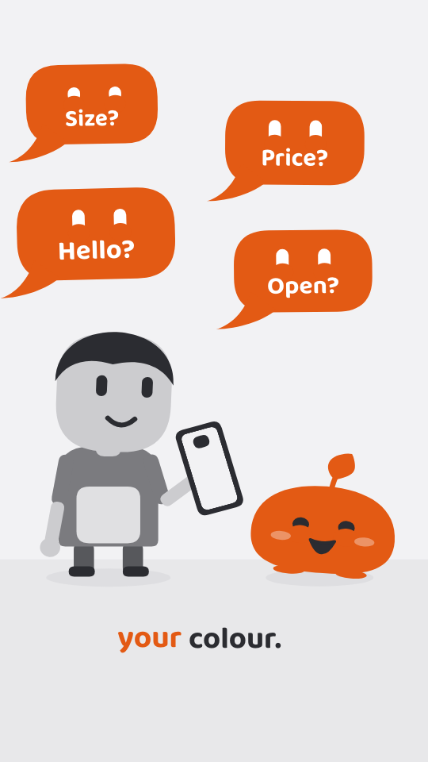

# Cartoon ads



Short vertical ads where everything is drawn in code, with SVG and HTML, and rendered frame by frame in headless Chromium at 1080 × 1920 and 30 fps. The world is grey. One thing in it carries your brand's accent colour: the mascot, a simple character of your own. When something on screen turns accent-coloured, the mascot took care of it. People, objects and messages with eyes act out a small everyday problem, the mascot solves it, and the logo lands on an end card with its own sound.

Use it when:

- the product does something for people that is easier to **act out** than to show on a screen (it answers, remembers, sorts, delivers, reminds);
- you want a series of short ads (10 to 30 s) with a recognisable character and one simple colour rule;
- there is no footage, no app capture and no budget for illustration: everything is code, so one person or one agent can make, re-time and rebrand a piece.

Use another bench for app walkthroughs on real screens or for data and calculations.

## The look

**A grey world and one accent colour.** People, shops, phones and messages are drawn in a ramp of neutral greys made from your background and ink colours (`K.G`: `skin1` to `skin4`, `mid`, `dark`). The mascot is the only thing in the accent. When it handles something, that thing turns accent too (`K.chatter(...).set(t, { accent: 1 })`, `K.mixHex(grey, K.C.accent, k)`). The audience learns the rule in seconds, so never spend the accent on decoration. The one typographic exception is the emphasised word in the captions.

**The mascot.** The placeholder is a round pebble on two small feet with one leaf sprout, dot eyes, a small smile and blush: a stand-in for your own character. Its shape lives in one file, [`engine/kit/mascot-shape.js`](engine/kit/mascot-shape.js) (body path, appendages, eyes, mouth, blush, gaze limits), so you can swap in your character without touching the rig. The rig poses it with channels and plays scenes: `blink`, `look`, `curious`, `hello`, `think`, `cheer`, `sleep`, `nod`, `land`. How to define yours is below the API.

**People, props and talking things.** People have big rounded heads, capsule eyes, flat grey clothes and a dozen options (body, hair, skin, clothes, glasses, apron, collar, tie, earrings, mustache). They talk (the mouth follows their voice's level), walk, look and hold props in either hand. Props: phone, bubble, notice, clock, bill, bag, shoe, store, receipt, loader, badge. A **chatter** is a message with eyes: it waits, gets sad, talks with its own voice, and cheers up in the accent colour when the mascot answers it.

**Particles.** `dots.js` turns plates (any image or SVG, read only as tone), text, the logo or the mascot into stippled dot sets. It draws them as ink on light grounds or as light on dark ones, morphs one into another (the dots of a word fly into the shape of the mascot and turn accent on the way), blows them away, bursts them and assembles the logo on a particle end card.

**Pictograms.** For the viral explainer format: flat one-colour figures with poses (`stand`, `think`, `point`, `shrug`, `walk`, `phone`, `cash`, `shh`, `sit`), objects (phone with a bubble, moon, sun, store, clock, cloud with rain, speech bubble, chair, cup, cross, ticks, bag, cash, warning), an old-film overlay (grain, dust, scratches, flicker, gate weave) and a VHS overlay (tracking streaks, a rolling noise band, torn frames).

**Camera and motion.** A slow camera always runs: push in while tension builds, pull back to reveal, a small jolt on impacts, a drift toward whoever acts. Scenes do not cut: one grows and fades while the next one arrives. Motion has weight: anticipation before a jump, `rise` and `fall` eases for gravity, squash on landing, appendages that follow through and settle with a spring.

**Transitions.** The mascot's own silhouette grows from its body until it covers the frame (`K.wipe`), straight into the end card in the same accent.

**Type and captions.** A rounded display face for titles and captions, a friendly sans for small text (defaults: Baloo 2 and Nunito, from Google Fonts). Captions come from the timeline, two to four words at a time, each word popping in as it is spoken, the `*emphasised*` word in the accent. Themes: `paper` (light grounds), `accent`, `ink` (dark grounds), `tile` (every word on its own tile for busy scenes), `caps` (the viral explainer's heavy capitals) and `typewriter` (typed word by word with a cursor; `typed: true` does it with any theme).

**The end card.** The accent fills the frame, the wordmark's letters rise out of the baseline without bouncing, and its dot drops from above, squashes on the baseline and bounces twice. The logo sound is scheduled by the card itself so its hit lands on the dot's first contact (`K.logo.LAND`, 1.08 s after the card starts). The brand line and the address rise after it, then a slow push-in keeps the hold alive. The placeholder wordmark is built from `brand.json` (`logo.text`, weight, and a round dot); point `logo.wordmark` at your own SVG and the whole logo drops and bounces instead.

## The story

A piece is one small situation with a turn, told in five beats. The sample follows it, and its `script.json` notes say what each slot is for.

| Beat | What happens | Typical length |
|---|---|---|
| Hook | The problem is already on screen in the first frame, in the viewer's words. A person and the first sign of trouble. | 2 to 3 s |
| Problem | The problem gets a voice: the waiting message, the object, the competitor across the street speaks. Things pile up; the camera pulls back to show how many. | 2 to 4 s |
| Turn | The mascot arrives (drops in, pops up, peeks in). Say what it does, not what it is. | 2 to 3 s |
| Payoff | It handles things one beat at a time; each one turns accent and cheers up; the person relaxes. | 3 to 4 s |
| Close | One promise, then the end card says the name. | 3 to 5 s with the card |

Pacing: fast without hurry. Every scene transforms into the next, nothing holds still, and one thing at a time asks for attention.

Formats that worked in production, all built from this kit:

- **The talking problem.** The thing that waited (a message, an order, a form) tells its own story in first person, deadpan, until the mascot answers it.
- **Particle documentary.** No characters: a word becomes the hands that typed it, the hands become the phone, the phone becomes a number, and the dots finally gather into the mascot.
- **Kinetic type with a twist.** Big sweet words on a dark ground that crack and fall when the truth is said; the accent wipes in with the mascot.
- **Viral pictogram explainer.** Light figures on a dark ground, old-film grain, typed capitals, numbered rules and an old-radio voice (`"effect": "radio"`). The mystery comes from secrets, rules and silence, never from the supernatural.
- **Reverse psychology.** A leaflet that warns against the product, listing "side effects" that are its benefits, with the mascot peeking in once.
- **Silent meme.** No voice, a line of text, a hard cut to "three days later". Set `"lines": []` in `script.json` and `duration` in the film.
- **The object is the mascot.** A loading bar fills, bends and jumps: it was the mascot all along.

## Audio

- **Voices.** One narrator plus a voice for each thing that speaks (`voices` in `script.json`, ids from the environment). Cast for character first: deadpan for talking objects, warm for the narrator. Record two or three takes per line and keep the best (`core/bin/wb voice <piece> --takes 3`); reject takes that whisper, rush the end of a sentence or misread a word. Test your brand name in every voice: some voices mispronounce short names. Any language works: the provider decides the accent.
- **Directions.** `[warm]`, `[a little tired]` and similar hints shape the delivery and are never spoken or captioned. Some newer models ignore `speed`: change the pace with the voice's `tempo` or a direction such as `[quick, no pauses]`.
- **Music.** Always audible, as in a commercial, and never over a word: `core/bin/wb mix` ducks it under the voice. `playful` at 100 to 112 bpm fits most pieces; `tension` for mystery formats. Map sections to beats (`"sections": [{ "at": "L03", "mood": "build" }]`).
- **Effects.** The film declares them where the action happens (`K.sfx(t, 'thud')`), so they move with the timeline. Accents land on actions: a `thud` on the landing, a `ding` per handled thing, a `pop` per arrival, a `swoosh` into the wipe, the `logo` sting on the dot. Whooshes peak a quarter of a second after they start: start them before the motion. Library names: `pop click tap tick whoosh swoosh riser hit thud ding bell coin typing paper camera logo` (`core/bin/wb sfx --list`), or drop your own `audio/sfx/<name>.wav` in the piece.
- **Loudness.** −14 LUFS integrated, true peak ≤ −1 dBTP after AAC encoding; `core/bin/wb mix` gets there and `core/bin/wb verify` checks it.

## Format

| | |
|---|---|
| Frame | 1080 × 1920, 30 fps, H.264 high profile, BT.709, yuv420p; AAC 256 kb/s, 48 kHz |
| Length | 12 to 25 s plus a 2 to 4 s end card hold (`tail` in `script.json`) |
| Safe area (Reels, Stories, Shorts) | Captions between x 96 and 912, centred around y 1600. Nothing important below y 1680 or right of x 930. |
| Captions | Display font, 78 px, two lines at most, emphasised word in the accent |
| Loudness | −14 LUFS, true peak ≤ −1 dBTP |

## Setup

From the repository root:

```sh
python3 -m venv .venv && .venv/bin/pip install -r core/requirements.txt                   # audio tools (numpy)
(cd benches/cartoon-ads && npm install && npx playwright install --only-shell chromium)   # Playwright + headless Chromium
core/bin/fetch-fonts.sh "Baloo 2:500,600,700,800" "Nunito:400,600,700,800,900" "JetBrains Mono:500,700"
brew install ffmpeg                                                                       # or your platform's package
```

`npm install` inside `core/node` works too: the renderer looks for Playwright in this bench first and then in `core/node`. Fonts land in `assets/fonts/` (git-ignored); without them the stage falls back to system fonts and says so.

## Make a piece

```sh
core/bin/wb new cartoon-ads my-ad                       # copies samples/00-sample to work/cartoon-ads/my-ad
P=work/cartoon-ads/my-ad
render() { node benches/cartoon-ads/engine/render.mjs "$@"; }
```

1. **Write `script.json`.** Short sentences written to be heard, one idea per line, `*emphasis*` on the word that carries the line (the film hangs its cues on it), `[directions]` for delivery. Place lines with `start`, `after` + `gap` or `with` + `offset`.
2. **Block out the timing without paying for voices.**
   ```sh
   WB_TTS_PROVIDER=silent core/bin/wb voice $P && core/bin/wb timeline $P
   ```
   Even without this step the renderer estimates a timeline from `script.json`, so you can draw from minute one.
3. **Animate `film.js`.** `build(K)` reads every time from the timeline (`K.line`, `K.word`) and makes everything once; `frame(t, K)` sets everything for second `t`. Put particle sources in `points.json` (built automatically before each render).
4. **Look at frames, one by one, in order.**
   ```sh
   render $P still 0.4,2.5,4.4,6.5,9.7,12.3,14.6,17.5     # renders/stills/f_XXX.XX.png
   render $P overlaps                                     # renders/overlaps.json: who covers whom, and when
   ```
5. **Record the real voices** when the edit works: `core/bin/wb voice $P --takes 3`, pick the takes in `voice/selection.json`, then `core/bin/wb timeline $P`. The whole film re-times itself.
6. **Sound.**
   ```sh
   render $P events                  # events.json from the film's K.sfx calls
   core/bin/wb music $P          # audio/music.wav from script.json "music"
   core/bin/wb mix $P            # audio/mix.wav: voices, ducked music, effects, −14 LUFS
   ```
7. **Preview, then master and verify.**
   ```sh
   render $P preview                 # renders/preview.mp4, half size, with the mix: watch it whole, with sound, at phone size
   render $P final                   # renders/final.mp4, 1080 × 1920
   core/bin/wb verify $P/renders/final.mp4
   ```

Other modes: `render $P poster 11.9 --out poster.png` (540 × 960 frame), `render $P stage` (writes `renders/stage.html`, a page with `window.render(t)` that `core/node/frames.mjs --page` can drive too). Options: `--from`, `--to`, `--workers`, `--crf`, `--silent`, `--scale`, `--step` and `--min` (overlaps).

The bundled sample renders as is:

```sh
cd benches/cartoon-ads
npm run still        # seven stills of samples/00-sample
npm run preview      # a silent half-size preview (no mix yet)
npm run overlaps
```

## The kit

All of it is plain browser JavaScript under `engine/kit/`, loaded into one stage page per piece. A film only talks to the global `K`.

**Timing** (from `timeline.json`, written by `core/bin/wb timeline`)

| Call | Returns |
|---|---|
| `K.line('L03')` | `{ id, voice, start, end, words, caption }` |
| `K.word('L03', 'help')` | the first word of L03 that starts with "help": `{ w, start, end, hot }`; `K.word('L03', 'it', 1)` is the second match, `K.word('L03', -1)` the last word |
| `K.level(t, 'L02')` | the voice's loudness 0..1 at `t` (the 50 Hz envelope; a syllable-like pulse from the word timings when the take is silent) |
| `K.speaking(t, 'guest')` | the line that voice is saying at `t`, or `null` |

**Motion**

| Call | What it does |
|---|---|
| `K.sample([[t, v, ease], ...], t)` | keyframes in seconds; each key's ease shapes the segment that ends on it |
| `K.tw(t, t0, t1, a, b, ease)` | a value easing from `a` to `b` |
| `K.prog(t, a, b)` | 0..1 progress |
| `K.pop(t, t0, d)` | 0 → 1 with a spring (entrances) |
| `K.E` | eases: `lin io out in fall rise ant move sine back spring soft firm` |
| `K.noise(t, seed)`, `K.hash(n)` | seeded randomness: renders repeat exactly |
| `K.camera(world, { x, y, z, r, shake })` | the point of the world in the frame's centre, zoom, roll, handheld shake |
| `K.place(el, x, y, s, r, ax, ay, op)` | place an HTML element by its anchor |
| `K.typed(t, t0, cps, text)`, `K.count(t, t0, t1, a, b)`, `K.words(parent, 'a *b* c')` | typewriter text, counters, per-word spans |

**Drawing**

| Call | What it makes |
|---|---|
| `K.el(tag, { cls, text, style }, parent)`, `K.svg(tag, attrs, parent)`, `K.stageSvg(parent, z)` | DOM and full-frame SVG layers (`K.root` for the scene, `K.top` for overlays and cards) |
| `K.mascot(parent, { size, color, eyes, seed })` → `.set(t, { x, y, s, r, op, scene, idle, 'eyes.dx': … })` | the mascot (HTML or SVG parent); `eyes` is the face colour (eyes and mouth, ink by default) |
| `K.mascotBox(x, y, size)`, `K.wipe(svgLayer, k, color, cx, cy)` | where a mascot is drawn (to place its particle set on it); the silhouette wipe |
| `K.person(svg, opts)` → `.set(t, pose)`, `.hand`, `.handL` | people (options and pose fields at the top of `people.js`) |
| `K.props.phone / bubble / notice / clock / bill / bag / shoe / store / receipt / loader / badge` | props, each `{ g, set(t, { x, y, s, r, op }) }` plus its parts |
| `K.chatter(svg, 'Price?', { voice })` → `.set(t, { accent, happy, sad, look, talk })` | a message with eyes |
| `K.dots.*`, `K.dotsCard(K.top, { at })` | particles (header of `dots.js`); the particle end card |
| `K.picto.*`, `K.oldFilm(K.top)`, `K.vhs(K.top)` | pictograms and analog overlays (header of `picto.js`) |
| `K.logo(parent, { color, width })`, `K.endCard(K.top, { at, line, url, bg, fg })` | the wordmark; the end card with its synced sound |
| `K.sfx(t, 'thud', { gain_db, pan, dur })` | a sound cue (`t` may be an anchor like `'L02:there'`) |

**The film object**: `bg`, `captions` (`{ theme, y, max, typed }` or `false`), `overlaps` (pairs that cover each other on purpose), `clearText` (default on: particles under captions and labels are erased with a soft edge), `duration` (pieces without voice), `build`, `frame`. Properties of the film name the elements for the overlap report (`this.owner` is reported as "owner"); prefix grounds, shadows and effects with `_` (`this._floor`) to leave them out. `K.hideCaptions = true` hides captions for a moment (titles that already say the words); `K.cap.theme('ink')` switches the caption theme when the ground changes.

**Defining your mascot.** Decide what makes it yours before you animate it, and keep those decisions in every piece:

- Pick one signature feature and keep it consistent: an appendage (ears, a sprout, antennae, a tail), an eye shape, a pattern. The placeholder's is its leaf sprout.
- Decide what never changes (the silhouette, the colour, the shape of the eyes) and what acts (gaze, blinks, mouth, body, appendages). Write both down next to your brand, so every piece and every animator uses the same character.
- Keep the face as simple as the silhouette: two eyes and, if you want one, a small mouth read at 200 px. Expressions come from the channels (`eyes.cheek` for joy, `eyes.lid` for sleep, `mouth.smile`, `mouth.open`, `mouth.o`), not from redrawing the face.

The rig follows general animation technique whatever the character: the gaze leads and the body follows, and looking far up is the body's job (lean or stretch it); squash and stretch keep the volume (`body.sx · body.sy` near 1); appendages follow through, lagging the body and settling with a spring. The idle layer (breathing, seeded blinks, one small fidget at a time) goes quiet while a scene plays, so blinks never fight the choreography. Scenes add up: `scene: [['land', t0], ['cheer', t1]]`, and channels in `set()` add on top (`'eyes.dx'` to aim the gaze, `'body.rot'` to lean).

**Particles.** `points.json` in the piece lists the sets:

```json
{ "promise": { "text": "Your promise.", "n": 7000, "w": 1100, "h": 300 },
  "hands":   { "plate": "plates/hands.png", "n": 22000, "gamma": 1.1, "edge": 0.8, "floor": 0.03, "screen": [0.41, 0.37, 0.59, 0.6] },
  "small":   { "mascot": true, "n": 5000 } }
```

`logo` and `mascot` always exist. A plate is any image or SVG next to the piece; only its tone is read, so it is never seen as a photo. Good plates are high-contrast black-and-white studio images of a single subject on pure white (hands with a phone, a shoe, a clock), from a photo you own, a drawing or an image model. `edge` keeps outlines, `floor` drops faint noise, `screen` marks a phone screen (0..1 of the image): it gets no dots, and `K.dots.place('hands').screen` tells the film where to draw the interface on top. Morph sets of equal size (`place(name, { n })` resamples without breaking the order that keeps morphs flowing).

## Review checklist

- [ ] The first frame already shows the problem: no empty ground, nothing waiting to appear.
- [ ] Stills at every scene change and every important gesture, opened one by one in order, at a size where text reads. Not a contact sheet.
- [ ] One focus per moment: text, camera and particles never compete.
- [ ] Only the mascot and what it handled are in the accent colour.
- [ ] `render.mjs <piece> overlaps` lists nothing unintended: no text over a character, no prop through a face. Intended crossings are declared in `overlaps`.
- [ ] Every cue comes from the timeline: re-render after the real voices and check the stills again.
- [ ] Captions sit in the safe area and match the voice word for word; emphasis falls on the word that matters.
- [ ] Nothing freezes: a camera move or a breath is always running, the end card pushes in slowly.
- [ ] Landings have anticipation, impact and recovery; the logo sound lands on the dot.
- [ ] Watch `preview.mp4` whole, with sound, at phone size: every word is intelligible over the music.
- [ ] `core/bin/wb verify renders/final.mp4` passes (format, −14 LUFS, true peak, no black or frozen stretches).
- [ ] Every claim is true of the product on the day it ships; any number has a source you can show.

## Rebrand

1. `brand/brand.json`: name, tagline, url, colours, fonts, locale, currency. `background` and `ink` make the grey ramp, so keep both neutral; `accent` must contrast with the background (3 : 1 or more for big shapes and caption words) and `accent_ink` must read on the accent. Check your accent on `ink` too: if it is weak, put the mascot in the light colour on dark grounds. A piece can override any key with its own `brand.json`.
2. Fonts: `core/bin/fetch-fonts.sh "<Display>:600,700,800" "<Body>:400,700,800"` and set `fonts` in `brand.json`. A rounded display face suits the style.
3. Logo: set `logo.text` and `logo.weight` for the placeholder wordmark, or `"wordmark": "brand/logo-wordmark.svg"` to use your own drawing (outlined paths, a `viewBox`, no embedded fonts).
4. Mascot: edit [`engine/kit/mascot-shape.js`](engine/kit/mascot-shape.js), or drop a `mascot-shape.js` with the same fields into `brand/` (or into a piece) to override it. Keep the base at `(0, 0)`, the eyes and mouth inside the body, nothing thin that vanishes when the body squashes, and a silhouette that reads at 200 px.
5. Voices: put voice ids in `.env` (`WB_VOICE_NARRATOR`, `WB_VOICE_GUEST`) and keep `script.json` free of ids.

## Lessons

- **The colour rule is the story.** Viewers learn "accent means handled" in the first payoff beat. Each extra accent element weakens it.
- **Hook on the first frame.** Open on the problem in progress, closer than the rest of the piece, and pull back to reveal how big it is.
- **Personify the problem.** A message that waited all night, the order nobody answered, the shop across the street: giving the problem eyes and a voice makes the viewer side with it.
- **A camera that never stops, scenes that never cut.** Each scene grows and fades while the next arrives; a frozen frame reads as a broken video and fails the delivery check.
- **Time from words, not seconds.** Cues hang on words of the timeline, preferably the emphasised one. Voices are re-recorded more often than you expect, and the film follows.
- **Weight sells the character.** Anticipation before every jump, gravity eases, a squash on every landing, appendages that overshoot. Without them the mascot looks like a sticker.
- **The eyes lead.** The gaze leads and the body follows; a blink on every change of direction; squinting cheeks for joy; lids for sleep.
- **A character people recognise is a consistent one.** One signature feature, one colour and one face, the same in every piece.
- **Text never fights particles or characters.** The stage erases particles under captions and labels on every frame, and the overlap report catches text over a figure before a viewer does.
- **Particles need equal counts and an order.** Hilbert-ordered sets resampled to the same `n` morph like a flock; unordered or unequal sets cross into noise. Plates are density only: give them strong contrast and a white ground.
- **Place interface on plates, not in them.** Mask the phone screen of a plate and draw real text on top: dots cannot carry small type.
- **Sound accents are actions.** Every landing, arrival and change has its sound, slightly ahead for whooshes, exactly on the hit for impacts and the logo.
- **Music is a commercial's music.** Audible between sentences, ducked under every word, resolved at the end of the piece.
- **Several takes, then choose.** Voices vary take to take; reject whispered or rushed ones. Directions in brackets steer the performance better than speed settings.
- **The logo is always the drawing.** Never retype the brand name in a scene font; use `K.logo` or the end card.
- **Truth first.** A beautiful ad does not make a claim true: show only what the product does on the day the ad runs, and use numbers you can source. Mind the ad platform's special categories (finance, housing, employment) before naming them.
- **Review the export, frame by frame.** A render that finishes without errors proves nothing about how it looks.

## Files

```
benches/cartoon-ads/
├── README.md
├── package.json                 Playwright (headless Chromium)
├── brand/brand.json             placeholder brand: name, colours, fonts, logo
├── docs/poster.png              a frame of the sample
├── engine/
│   ├── render.mjs               still | preview | final | events | overlaps | poster | stage
│   ├── points.mjs               particle sets from points.json (run by render.mjs)
│   ├── lib/                     piece loading and timeline estimate, fonts, capture and encoding, stippling, PNG decoding
│   └── kit/                     the stage: kit.js (time, motion, camera, captions, sound), mascot-shape.js, mascot.js,
│                                logo.js (wordmark, end card), people.js, props.js (and chatter), dots.js, picto.js,
│                                raster.js (particle sources), kit.css
└── samples/00-sample/           script.json, film.js, points.json: the guiding sample
```

Generated files stay next to the piece and out of git: `voice/`, `audio/`, `timeline.json`, `events.json`, `renders/`, `cache/`.

## Credits

- Stippling follows Adrian Secord, [Weighted Voronoi Stippling](https://www.cs.ubc.ca/labs/imager/tr/2002/secord2002b/secord.2002b.pdf) (NPAR 2002).
- The 2D simplex noise follows Stefan Gustavson, [Simplex noise demystified](https://itn-web.it.liu.se/~stegu76/simplexnoise/simplexnoise.pdf).
- Rendering with [Playwright](https://playwright.dev) and [FFmpeg](https://ffmpeg.org); default fonts [Baloo 2](https://fonts.google.com/specimen/Baloo+2) and [Nunito](https://fonts.google.com/specimen/Nunito) (SIL Open Font License).
