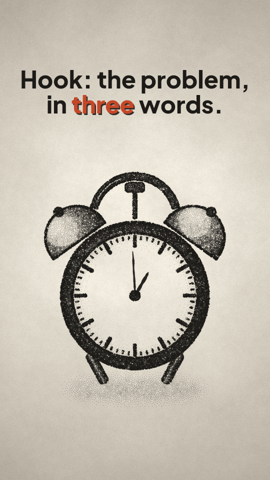

# Micro-ad series



Many short vertical ads, 6 to 25 seconds each, every one with **one idea, one message and one visual punch**, all made in the same workshop so the series keeps one look. A catalogue of ideas (`ideas.json`) decides what to make and tracks each episode's status; a shared kit of scenes, a bank of stippled plates and one end card do the rest. Each episode is a small folder with its script and a short `film.js`.

The look is the particle-film engine's (stippled objects, boiling pencil lines, paper, light at night), used with more type and faster beats: big kinetic words carry the message for muted viewing, one object transforms, a phone shows the proof, and the brand closes with the offer. 1080 × 1920, 30 fps.

Use it when:

- you need a steady flow of social ads (a batch of 10, 30 or 100) that test different hooks and messages for the same product;
- each ad can say **one** thing: a feature, an objection answered, a moment of the customer's day;
- you want every claim checked against what the product really does before a voice is recorded.

Use `particle-film` for a single longer brand film, `cartoon-ads` for character comedy.

## How the series works

| Piece | Where | What it holds |
|---|---|---|
| Catalogue | `ideas.json` | One entry per episode: `id`, `slug`, `title`, `format`, `world`, `duration`, **`hook`** (the first two seconds), **`premise`** (the situation), **`message`** (the single thing the viewer keeps), `claim` (an id from `claims.json`), `voices`, `status`, `order` |
| Claims | `claims.json` | What the product can say today (`allowed`, each with its proof), what it must never say (`forbidden` patterns), what to double-check (`warn`), competitors never to name |
| Workshop | `engine/` | `kit.js` (scenes, worlds, end card), `bank.js` (plates and their stipple settings), `render.mjs` (runs on `../particle-film/engine`) |
| Episodes | `episodes/NNN-slug/` | `script.json` (lines, voices, end-card copy, music) and `film.js` (the scenes); generated `voice/`, `timeline.json`, `events.json`, `audio/`, `renders/` |
| Tools | `tools/` | `catalogue.mjs` (board, checks, status), `new-episode.mjs` (folder from an idea), `lint-script.mjs` (claims and voice rules) |

Status flow: `idea` → `draft` (folder created) → `scripted` (lint passes) → `voiced` → `cut` (picture locked) → `rendered` (final verified) → `delivered`; `sample` marks the bundled guiding episode, `dropped` an idea you abandoned.

The catalogue ships with four instructive slots. Fill them, add more (three-digit ids, lowercase slugs) and order them so the strongest and most varied ideas come first: the first episodes teach you what the series is.

## Formats

Pick one per idea (`format` in `ideas.json`); they all use the same kit.

| Format | What carries it |
|---|---|
| `MORPH` | One object's dots become another (the problem becomes the answer) |
| `TYPE` | Kinetic type: big words, the emphasised one slams in the accent |
| `CHAT` | A conversation on a phone where the product does the work |
| `CLOCK` | Time passing or a counter rolling: what is lost, what is kept |
| `LIST` | Three steps, two myths, one rule; numbered, each on a beat |
| `DEMO` | The product in action on its real screen |
| `POV` | The customer's point of view, thumb on the phone |
| `MONO` | One person talks to camera (hands, objects, never a face) |
| `DUO` | Two voices, a short exchange with a turn |
| `FAQ` | A question written by hand, a short answer |
| `ASMR` | Sound leads: the work's own noises, few words |

**Worlds** (`world`): `paper` (warm sheet, ink dots), `brand` (your accent as the ground, ink in a contrasting tone), `night` (dark sheet, dots of light, bloom), `kraft` (brown paper). One world per episode; the end card is always on paper (on night for night episodes).

## The recipe of an episode

| Beat | Time | Rule |
|---|---|---|
| Hook | 0–2 s | The first frame already has content; the problem in the viewer's words, as big text and an object |
| Message | 2–8 s | One sentence, one transformation; the `*emphasised*` word lands in the accent |
| Proof | 3–5 s | A phone, a number, a voice: something the viewer can believe |
| End card | 3–4 s | Paper rises from below, the dots gather into the logo, the wordmark, the offer from `script.json` `card` |

Big kinetic text (`autoText: true`) shows every spoken line word by word, sized by its length and kept inside the safe zone; turn captions off when it is on. A line whose words appear elsewhere (a voice note with its transcript) gets `"caption": false` in the script and stays out of the kinetic text too.

The end card never changes between episodes: same timing, same layout, only its copy (`card.offer`, `card.offer2`, `card.sub`, `card.cta`, `card.fine`). Check every offer and condition before publishing.

## Audio

- **Voices**: a narrator plus whoever speaks (`voices` in each `script.json`; ids from the environment, e.g. `${WB_VOICE_NARRATOR}`). Short, natural lines with a `[direction]` each. Never whispered: the lint rejects whisper-prone tags. Write numbers as words.
- **Music**: procedural (`core/bin/wb music`), `playful` at 100–115 bpm for most, `ambient` for night, `tension` for a problem-led hook; sections `intro` → `main` → `lift` on the lines.
- **Effects**: declared in `film.js` with `sfx(t, name, gain_db)` next to the action, exported with `render.mjs <episode> events`; the kit adds the end card's `whoosh` and `logo` itself. Library: `pop click tap tick whoosh swoosh riser hit thud ding bell coin typing paper camera logo`.
- **Mix**: `core/bin/wb mix` → −14 LUFS, true peak ≤ −1 dBTP after AAC.

## Format

| | |
|---|---|
| Frame | 1080 × 1920, 30 fps, H.264 high (x264 slow, CRF 23, 14 Mb/s ceiling: about 30 MB for 20 s), AAC 256 kb/s |
| Length | 6–25 s including a 3–4 s end card (`tail` ≈ 4.2 in `script.json`) |
| Safe zone | Text between y 262 and 1250, x 65–1015 |
| Loudness | −14 LUFS, true peak ≤ −1 dBTP |

## Setup

This bench runs on the particle-film engine. From the repository root:

```sh
npm --prefix benches/particle-film install       # once (or: cd benches/micro-ad-series && npm run setup)
python3 -m venv .venv && .venv/bin/pip install -r core/requirements.txt
core/bin/fetch-fonts.sh "Plus Jakarta Sans:500,600,700,800" "Inter:400,500,600,700" "JetBrains Mono:400,500"
```

## Make an episode

From `benches/micro-ad-series/` (so the paths below are short):

```sh
node tools/catalogue.mjs                       # the board
node tools/new-episode.mjs 002                 # episodes/002-<slug>/ from idea 002 (status → draft)
E=episodes/002-slot-chat
```

1. **Idea first.** In `ideas.json`, write the hook, premise and single message, and point `claim` at a claim in `claims.json` that you can prove. `node tools/catalogue.mjs --check`.
2. **Script.** Write the lines in `$E/script.json` (three or four short lines; `*emphasis*` on the word the punch lands on) and the end-card copy in `card`. Then `node tools/lint-script.mjs $E` until it reports no errors; `node tools/catalogue.mjs --set 002 status=scripted`.
3. **Block out.** Stills work before any voice (timings are estimated): `node engine/render.mjs $E still 1,3,6,9,12`.
4. **Voices and timeline.** `../../core/bin/wb voice $E --takes 3`, keep the best takes in `voice/selection.json`, `../../core/bin/wb timeline $E`.
5. **Scenes.** Edit `$E/film.js` (see The kit). Review stills one by one at each scene change.
6. **Sound.** `node engine/render.mjs $E events`, then `../../core/bin/wb sfx $E`, `../../core/bin/wb music $E`, `../../core/bin/wb mix $E`.
7. **Preview and master.** `node engine/render.mjs $E preview`, watch it with sound at phone size; `node engine/render.mjs $E final`; `../../core/bin/wb verify $E/renders/final.mp4`. Then `--set 002 status=rendered`.

The bundled sample works the same way: `episodes/001-first-episode` (`npm run still`, `npm run preview`, `npm run lint`). Render modes and options are those of the particle-film engine; `WB_CAPTIONS=0` renders without captions.

## The kit

```js
const { defineEpisode } = require(`${process.env.WB_ENGINE}/kit`);   // the renderer sets WB_ENGINE

module.exports = defineEpisode(__dirname, ({ L, W, Hot, along, T, sfx, ui }) => ({
  world: 'paper',
  plates: ['clock', 'bulb'],                       // names from engine/bank.js
  captions: false,
  autoText: { y: 360 },                            // big kinetic words of every spoken line
  card: { lock: T.lastEnd + 1.6 },                 // copy comes from script.json "card"
  scenes: [
    { at: 0, to: L('L02').start, draw(u) {
      u.paper();
      u.plate('clock', { cy: 1180, h: 1500, n: 24000, appear: u.p(0, 0.9, 'linear') });
    } },
    { at: L('L02').start, to: 'card', draw(u) {
      u.paper();
      u.morph('clock', 'bulb', u.clamp(u.lt / 1.1), { cy: 1180, h: 1500, n: 24000 });
    } },
  ],
  events: [sfx(Hot('L01').start, 'hit', -16)],
}));
```

Scenes are `{ at, to, draw(u) }`; `to` may be a time, `'card'` (until the end card covers the frame) or `'end'`. Overlapping scenes draw in order: to cross-fade, let the later scene skip `u.paper()` during the overlap while the earlier one fades its content out. `u` is the scene's context for one frame:

- **Time**: `u.t` (absolute), `u.lt` (since the scene started), `u.p(a, d, ease)` / `u.pa(a, d, ease)` progress of a window, `u.win(a, b)` a soft on/off window, `u.L`, `u.W`, `u.Hot`, `u.along`.
- **Ground and camera**: `u.paper()`, `u.cam({ x, y, z, r })`, `u.camPath(keys)`, `u.shake(t0, amp)`, `u.wipe(p, { world })`.
- **Dots**: `u.plate(name, { cx, cy, h, n, appear, fade, wind, from, seed })`, `u.morph(a, b, p, { cx, cy, h, n, swirl })`, `u.outline(name, { progress })` (pencil contours), `u.burst({ x, y, at, n, speed })`, `u.placed(name, place)` (screen, dial and anchors of a placed plate).
- **Phones**: `u.phone((c, t, h) => ui.drawChat(c, t, { h, items, valign: 'center' }), { x, y, w })` a loose phone; `u.screen(S, draw)` inside a plate's measured screen; `u.phoneShot(name, place, { Z, draw })` the camera travels from the hand to its screen. `ui` (`appui`) draws a flat app in your brand's tokens: `drawChat` (text, voice notes with live transcripts, confirmation cards, typing), `drawList` (rows that pop in, highlights, rolling counters), `icon`.
- **Type**: `u.text(str, { x, y, size, in: { at, kind: 'pop' | 'rise' | 'slam' | 'drop' | 'left' | 'right' | 'type' | 'wipe' }, out })`, `u.rich(parts)`, `u.pill(str)`, `u.kinetic(lineId, o)`, `u.counter({ from, to, at, prefix, suffix })`.
- **Ink**: `u.ink(pts)`, `u.circle(x, y)`, `u.underline(x0, x1, y)`, `u.arrow(x0, y0, x1, y1)`, `u.check`, `u.cross`, `u.swash`, `u.stamp(label, { at })`, `u.row({ left, title, sub, state })` (a list row: on, free, cancelled, waiting, done), `u.bubble(b)`, `u.voiceNote(o)`, `u.notif(o)`, `u.person(x, y)`, `u.avatar(x, y, { initials })`, `u.tap(x, y, { at })`.

## Plates

The bank (`engine/bank.js`) names every plate an episode can use, with its stipple settings, so the series keeps one density and line weight. It starts with the procedural plates of the particle-film engine: `hand-phone`, `clock`, `person`, `bulb`, `mug`, `plane`. Add your own: make a plate from any photo with `node ../particle-film/tools/plate-from-image.mjs photo.jpg plates/<name>.png [--screen]`, register it as `name: { src: 'plates/<name>.png', N: 26000 }`, and compare settings with `node ../particle-film/tools/probe-plate.mjs plates/<name>.png '{"gamma":1.3}'`. Isolated subjects on white stipple best; for a plate that should fill the frame, scale it so its crop edges match the frame edges.

## Review checklist

- [ ] The idea has one message and a provable claim; `node tools/lint-script.mjs <episode>` reports no errors.
- [ ] The hook works in the first two seconds, muted; the first frame has content.
- [ ] Kinetic text and captions stay inside the safe zone and never overlap each other or the phone.
- [ ] Every scene change reviewed frame by frame: no object vanishes in one frame, no text collides with what arrives.
- [ ] The proof is readable at phone size (push the camera in on a phone).
- [ ] The end card: dots gather into the logo, the copy is current and true, the URL is right.
- [ ] Sound checked whole: voice clear and never whispered, music audible under it, hits on actions not on key words.
- [ ] `core/bin/wb verify <episode>/renders/final.mp4` passes; status updated in `ideas.json`.

## Rebrand

Edit `brand/brand.json` (name, colours, fonts, `logo.mark`, `logo.wordmark`), replace `brand/logo-mark.svg`, rewrite `claims.json` for your product (claims you can prove, your competitors, your sector's forbidden promises), and fill `ideas.json` with your ideas. The worlds derive from the brand colours: `paper` from `background` and `ink`, `brand` from `accent` (text turns dark or light to stay readable). Scripts can be in any language; adapt the lint patterns in `claims.json` to it.

## Lessons from production

- **One idea, one message.** An episode that says two things says none. Write the message in the catalogue before the script.
- **Claims are checked before a voice exists.** Say only what the product does today; no promised results, income or time, no figures without a source, no personal situation attributed to the viewer, no competitor names. These are also the reasons ad platforms reject ads.
- **A workshop, not copies.** One kit, one plate bank and one end card shared by every episode keep the series consistent and make episode 40 as fast as episode 4. Episode folders hold only what differs.
- **Big words for muted viewing.** Kinetic text carries the line; the emphasised word lands bigger, in the accent, with a little shake. Keep the block below the top 14% of the frame and above the bottom 35%.
- **Transitions are overlaps.** The next scene arrives while the previous one leaves (dots blow away, a phone rises after the headline clears); nothing disappears in one frame.
- **Numbers as words, phrases the voice can say.** Rewrite a line the voice keeps mangling instead of fighting the take. Never whispered takes.
- **Small files.** 30 fps, CRF 23 with a 14 Mb/s ceiling and grain on drawn frames give about 30 MB per 20 s without visible loss on a phone.
- **Track everything in the catalogue.** Status, order and notes in `ideas.json` tell anyone (or any agent) what to make next and what is done.

## Files

```
benches/micro-ad-series/
├── README.md
├── package.json              scripts; "setup" installs the particle-film engine
├── ideas.json                the catalogue (four instructive slots)
├── claims.json               allowed / forbidden / warn claims for the lint
├── engine/
│   ├── render.mjs            entry point (contract): <episode> still|sheet|preview|final|poster|events
│   ├── kit.js                defineEpisode: worlds, scene context `u`, kinetic text, end card
│   └── bank.js               the plate bank
├── tools/                    catalogue.mjs, new-episode.mjs, lint-script.mjs
├── brand/                    brand.json and a neutral placeholder mark
├── episodes/001-first-episode/   the guiding sample (script.json + film.js)
└── docs/poster.png
```

Pieces of this bench are episodes in `episodes/` (the contract's `samples/<piece>`); `tools/new-episode.mjs` creates them from the catalogue.
