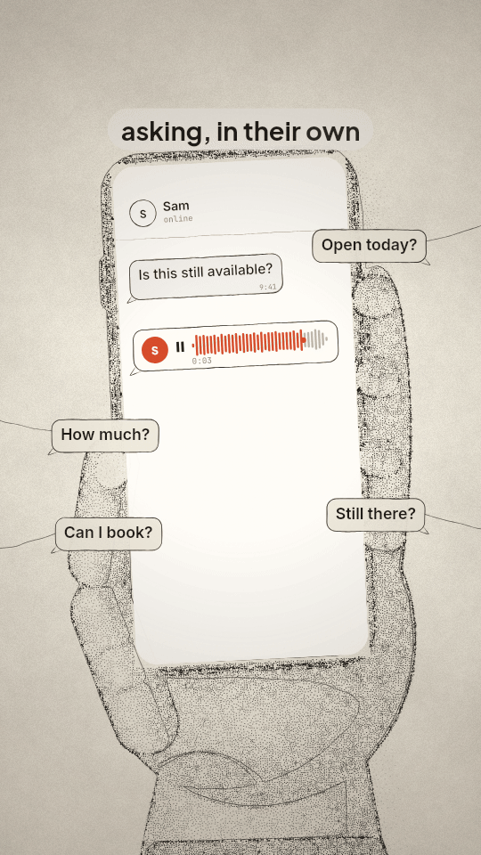

# Particle film



A narrative brand film drawn entirely in code, frame by frame. Hands, objects and people appear as stippled dots, like an engraving, outlined in boiling pencil strokes on warm paper. The dots carry the story: a hand holding a phone swirls into a clock, ink floods the page, the same dots light up in the dark as a person, and finally fly together into your logo. Several voices talk, captions follow every word, and nothing cuts: one continuous shot from the first frame to the end card.

It is rendered with Skia ([@napi-rs/canvas](https://github.com/Brooooooklyn/canvas)) in Node, one deterministic frame at a time, and FFmpeg muxes the frames with the mix. Vertical 1080 × 1920, 60 fps, 25 to 70 s.

Use it when:

- you sell an **idea or a feeling** (time saved, a conversation answered, a worry gone) better shown as objects that transform than as screens;
- you want a crafted, premium film for paid social or a launch, with a story told by hands and objects instead of characters;
- the product appears briefly (a phone screen in a hand, a chat, a list) and the brand only at the end.

Use `micro-ad-series` for many short single-message ads in the same look, and `app-tutorial` to teach a feature on real screens.

## The look

**Paper and ink.** A warm drawing sheet (three sheets with different fibres, alternating 12 times per second, so even the page "boils"), dots of ink for tone, pencil lines for silhouettes, and one accent colour. A red rubber stamp is the only other colour, used once.

**Stippled plates.** Every object is a *plate*: a black-and-white guide image (a photo, or one drawn procedurally) that is never shown. The engine turns its tone into 20 000 to 40 000 well-spaced dots (weighted Voronoi stippling, [Secord 2002](https://www.cs.ubc.ca/labs/imager/tr/2002/secord2002b/)) whose size and opacity follow the darkness underneath. The edges are emphasised so outlines survive, and pencil contours traced from the same plate (iso-luminance lines) are drawn on top as graphite.

**Boil.** Dots jitter, lines wobble, paper and grain change on *drawn frames*, 12 per second, while the camera moves at the full 60 fps. The film feels hand-made without strobing.

**Particles that transform.** Two plates with the same number of dots, both sorted along a Hilbert curve, can swap: each dot leaves at its own moment, swirls through curl noise that peaks mid-flight and lands in the next object. An object can also *engrave itself in* (the darkest dots first, like an engraver), or *blow away* (dots leave in random order, carried by wind).

**Night.** The same dots, re-lit as additive light with bloom on a dark sheet. The switch is an ink flood from the top of the page; the lights come on from the point of interest outwards. Light dots are warm white, the accent glows.

**One shot.** Acts overlap in time; a transition is two acts drawn in the same frame, never a cut. The camera pulls back from a macro, pushes in, tilts between worlds. Fast moves get physically based motion blur (the on-screen travel during a 180° shutter).

**Story devices** (`engine/lib/fx.js`): ink threads between people with beads running along them (a conversation, money, attention), a rubber stamp that slams onto the frame with ink speckles and a camera kick, the ink flood, a comet of light, spark streams. Chat bubbles are drawn in ink with a typed-on text; voice notes show a waveform cut from the line's real loudness envelope and a playhead that follows the audio.

**Type.** Two families from the brand: the display face for captions and the end card, the body face for bubbles and UI. Captions sit on a soft pill, 58 px, two to four words at a time, each word arriving on its timestamp; the `*emphasised*` word takes the accent. On paper the pill is paper-white; at night it disappears into the dark.

**The end card.** The last scene's dots fly and assemble into your logo mark, coloured as the mark. The exact logo file takes over as the dots settle (the final frame is the real asset, never an approximation), with a flash of light at night or an ink ring on paper. The wordmark wipes in under it, then the tagline and the URL. The brand appears nowhere else.

## The story

Five lines, one turn. The sample's `script.json` lines are slots that say what goes there.

| Beat | Voice | Picture | Length |
|---|---|---|---|
| Hook | Narrator: the problem, in one sentence, to the viewer | Macro on a message in a phone; pull back to the hand holding it | 3–5 s |
| The ask | A customer, as a voice note | The voice note arrives; the asks pile up around the phone on threads | 3–5 s |
| The cost | Narrator: what the wait loses, as one concrete image | The hand's dots become a clock; time races; a stamp lands on the emphasised word; ink floods the page | 4–6 s |
| The turn | The owner: how the day feels once it is solved | In the dark, the clock's dots light up and become the owner, seen from behind; a comet circles them | 3–5 s |
| Promise + brand | Narrator: one line, then the brand name | The dots gather into the logo exactly as the name is spoken | 4 s + 3–4 s hold |

Rules that held up: nobody appears full-body and nobody is drawn as a puppet; people are hands, objects and figures seen from behind. The first frame already shows content. Every movement is anchored to a spoken word. The brand only at the end, the call to action apart from the logo.

## Audio

- **Voices.** A narrator plus one voice per person who speaks (here a customer and an owner). Cast for the role, in the accent of the script (write the lines in the language variety the voice speaks; a neutral text read with an accent sounds dubbed). Record two or three takes per line (`core/bin/wb voice <piece> --takes 3`), keep the best in `voice/selection.json`. Reject any take that whispers, rushes the end of a sentence or changes a word. Never use direction tags that lower the voice (`[whispers]`, `[softly]`, `[intimate]`...): use `[warm]`, `[matter-of-fact]`, `[curious]`.
- **Lines that are messages** (`"effect": "voice-note"` or `"phone"`) get a band-limited sound in the mix and should appear on screen as a voice note.
- **Music.** Procedural bed from `script.json.music` (`core/bin/wb music`). `tension` or `ambient` suit this style; map sections to the beats: `intro` on the hook, `build` from the ask, `break` (pad only) on the turn, `lift` on the promise; the bed resolves on the end card. It must be audible like in a commercial and never cover a word.
- **Effects.** The film declares them with the same formulas as the picture (`events` in `film.js`), and `render.mjs <piece> events` writes `events.json`: `pop` per bubble, `typing` under typing dots, `ding` when a voice note arrives, `whoosh` on pull-backs and the flood, `swoosh` on each morph, `tick` per clock jump, `hit` on the stamp, `riser` into the gather, `logo` on the lock. Keep hits off the key words.
- **Loudness.** `core/bin/wb mix` levels the voices, ducks the music about 10 dB under them, adds the effects and normalises to −14 LUFS with true peak ≤ −1 dBTP checked after AAC encoding.

## Format

| | |
|---|---|
| Frame | 1080 × 1920, 60 fps master (previews at 30 fps, half size), H.264 high, yuv420p, BT.709; AAC 256 kb/s 48 kHz |
| Encode | x264 slow, CRF 19, 16 Mb/s ceiling (about 2 MB per second of film) |
| Length | 25–70 s, plus a 3–4 s end-card hold (`tail` in `script.json`) |
| Safe zone | Captions and copy between y 250 and 1250 and x 65–1015 (Reels and Stories cover the top 14%, the bottom 35% and 6% at each side) |
| Loudness | −14 LUFS integrated, true peak ≤ −1 dBTP |

## Setup

Requirements: Node 20+, FFmpeg, Python 3.11+ for the shared audio tools. From the repository root:

```sh
npm --prefix benches/particle-film install                 # Skia for Node (@napi-rs/canvas)
python3 -m venv .venv && .venv/bin/pip install -r core/requirements.txt
core/bin/fetch-fonts.sh "Plus Jakarta Sans:500,600,700,800" "Inter:400,500,600,700" "JetBrains Mono:400,500"
cp .env.example .env                                       # optional: voice provider keys and voice ids
```

Without fonts the film still renders, with the system sans-serif. Without keys, `WB_TTS_PROVIDER=silent` times everything with estimated silence.

## Make a film

```sh
core/bin/wb new particle-film my-film              # copies samples/first-film to work/particle-film/my-film
P=work/particle-film/my-film
```

1. **Script.** Edit `$P/script.json`: five short lines, one idea each, `*emphasis*` on the word a visual beat should land on (the stamp lands on the cost line's emphasis, the logo locks on the last line's), `[direction]` hints, numbers written as words. Voice ids come from the environment (`"voice": "${WB_VOICE_NARRATOR}"`).
2. **Block out before recording.** The engine estimates word timings when there is no `timeline.json` yet, so you can already render stills: `node benches/particle-film/engine/render.mjs $P still 1,5,9,13,17,21`.
3. **Voices and timeline.** `core/bin/wb voice $P --takes 3`, listen, fix `voice/selection.json`, then `core/bin/wb timeline $P`. Every cue in the film re-times itself from `timeline.json`.
4. **Plates.** Use the procedural ones (`src: 'procedural:hand-phone'`, `clock`, `person`, `bulb`, `mug`, `plane`) or make your own from any photo (see Plates). Tune them with `node benches/particle-film/tools/probe-plate.mjs <src> '{"gamma":1.3}' ...`.
5. **Film.** Edit `$P/film.js` (see Writing a film). Review stills at every transition, one by one, in order: `render.mjs $P still t1,t2,...`; a quick overview: `render.mjs $P sheet 0:30:1`.
6. **Sound.** `node benches/particle-film/engine/render.mjs $P events`, then `core/bin/wb sfx $P`, `core/bin/wb music $P`, `core/bin/wb mix $P`.
7. **Preview** (30 fps, half size, with the mix): `node benches/particle-film/engine/render.mjs $P preview`. Watch it whole, with sound, at phone size.
8. **Master and checks:** `node benches/particle-film/engine/render.mjs $P final`, then `core/bin/wb verify $P/renders/final.mp4 --fps 60` (add `--max-mb` for films over ~28 s).

The bundled sample renders the same way: `benches/particle-film/samples/first-film`. Render modes and options: `still t1,t2` · `sheet a:b:step` · `preview` · `final` · `poster [t] --out file` · `events`; `--scale`, `--fps`, `--workers`, `--from`, `--to`, `--crf`, `--maxrate`, `--audio`, `--out`, `--silent`. `WB_ACTS=hook,cost` renders only those acts; `WB_CAPTIONS=0` hides captions.

## Writing a film

A piece's `film.js` returns a builder to `defineFilm`. The builder runs once the timeline and brand are loaded, so every time can come from the voice:

```js
const { defineFilm } = require(`${process.env.WB_ENGINE}/lib/film`);   // the renderer sets WB_ENGINE

module.exports = defineFilm(__dirname, ({ L, W, Hot, along, T, P, cam, fx, ink, bubbles, voicenote, math, env, Frame }) => {
  const lock = Hot('L05').end + 0.15;                 // the logo completes on the emphasised brand name
  let HAND, CLOCK;
  return {
    plates: { hand: { src: 'procedural:hand-phone', N: 30000, screen: true }, clock: { src: 'procedural:clock' } },
    setup() { HAND = P.place(P.plate('hand'), { cx: 540, cy: 1180, h: 3000, n: 26000 }); CLOCK = P.place(P.plate('clock'), { cx: 540, cy: 1150, h: 2600, n: 26000 }); },
    acts: [
      { name: 'hook', start: 0, end: L('L03').start, draw(f, t) {
        f.cam = cam.camPath([[0, 540, 700, 2], [L('L01').end, 540, 1150, 0.65]], t);
        env.paper(f, t);
        P.drawSet(f, HAND, { appear: math.clamp(t / 1.5) });   // engraves itself in, darkest dots first
        f.flushInk();
      } },
      { name: 'cost', start: L('L03').start, end: lock - 1.6, draw(f, t) {
        env.paper(f, t);
        P.drawMorph(f, HAND, CLOCK, math.clamp((t - L('L03').start) / 1.3), { swirl: 90 });
        f.flushInk();
      } },
    ],
    captions: { y: 290 },
    endCard: { lock, gather: 1.6, world: 'paper', source: (t) => ({ from: CLOCK }) },
    events: [{ t: L('L03').start, name: 'swoosh', gain_db: -14 }],
  };
});
```

**Anchors** (`engine/lib/timeline.js`): `L(id)` a line `{ start, end, words }`; `W(id, 'word', n)` the n-th word starting with that text (accents and case ignored); `Wi(id, i)` by index; `Hot(id, n)` the n-th `*emphasised*` word (the best anchor: rewrite the line, keep the asterisks, the beat follows); `along(id, k)` a fraction of the line; `T.lastEnd`, `T.duration`.

**Acts** are `{ name, start, end, setup?, draw(f, t, env) }`. Each act draws its own ground (`env.paper(f, t)` or `env.night(f, t)` plus `env.nightPost()`), sets `f.cam = { x, y, z, r }` and may set `env.captionTone = 'night'`. Acts that overlap are drawn in order in the same frame.

**The frame** (`engine/core/frame.js`): design space is 1080 × 1920 whatever the output scale. `f.dotInk / f.dotLight(x, y, r, alpha, [r, g, b])` splat dots into float layers, `f.flushInk()` / `f.flushLight(alpha, toGlow)` composite them; `f.withLayer((c) => ..., { alpha, cam, tooth, glow })` draws vector work (strokes, bubbles, UI) through the camera, with paper-tooth erosion for graphite; `f.project / f.unproject` convert world ↔ screen; `f.autoMotionBlur(camFn, t)` on whip pans (`Frame.camSpeed(camFn, t) > 900`); `f.finish(post)` adds bloom, vignette, flicker and grain.

**Plates** (`engine/lib/plates.js`): `P.place(P.plate(name), { cx, cy, h, n, flip })` puts a plate in the world and returns its dots plus `screen` (phone screen rect, tilted), `dial` (clock face) and `anchors` in world units. `P.drawSet(f, S, o)` with `o`: `mode` ink|light, `col`, `alpha`, `r0`/`r1` (dot radius by density), `appear`, `from {x, y, spread}`, `fade`, `wind`, `gain`, `tint(i, x, y)`, `clip`, `skip`, `screenR`. `P.drawSetXf` moves a set rigidly (rotate, scale, translate: a tool in a hand). `P.drawMorph(f, A, B, p, { swirl, stagger, colB, gainA, gainB })`. `P.drawContours(c, S, { progress, alpha, width, max, colorOf })` draws the traced pencil outline.

**Camera** (`engine/lib/cam.js`): `camPath([[t, x, y, z, roll], ...], t)` is a monotone cubic through keys (no overshoot, so holds hold) with zoom interpolated in log space; `shake(t, t0, amp)` for impacts. For journeys between places without a cut, nest a whole scene inside one point of a bigger world (a map of dots, K = 40 times smaller): `toNested(parentCam, anchor)` gives the camera to draw the nested scene with while diving in, `toParent(nestedCam, anchor)` the reverse, and `hop(fromCam, toCam, p)` zooms out of one place, pans across the parent and dives into the other.

**Devices** (`engine/lib/fx.js`, `engine/draw/*.js`): `fx.inkThread`, `fx.lightThread`, `fx.threadPoint`, `fx.stamp(ctx, t, t0, { label, sub, color })`, `fx.flood(ctx, p, t)`, `fx.comet(f, pathFn, t)`, `fx.sparkStream`; `ink.sketch(ctx, pts, { width, boil, passes, taper, progress, over })`, `ink.hatch`, `ink.gestures`, `ink.flattenSvgPath`; `bubbles.drawBubble(ctx, { x, y, text, side, tone, appear, typed, time })`, `bubbles.drawTyping`, `bubbles.drawSeen`; `voicenote.drawVoiceNote(ctx, { x, y, w, h, line, t, initials })`; `appui.drawChat` / `appui.drawList` / `appui.icon` for a flat phone app in your brand's tokens.

**Captions** (`captions:` in the config): `{ y: number | (t) => y, maxWords: 4, hold: 0.5, skip: ['L02'], size: 58 }` or `false`. Lines with `"caption": false` in `script.json` never get captions (use it for voice notes whose transcript is on screen).

**End card** (`endCard:`): `{ lock, gather, world: 'paper' | 'night', N, markY, markSize, wordY, wordH, tagline: true | 'text', url: true, cta, copy: [{ text, role: 'offer' | 'sub' | 'cta' | 'fine' }], source(t) → { from: placedSet, fromCam, inkCol, style: { r0, r1, gain } } }`. The act that draws the source dots must end at `lock - gather`, and `style` must match how it drew them, so the hand-over is invisible.

## Plates

A good plate is a high-contrast black-and-white image of **one subject on pure white**: deep blacks where you want dense dots, clean highlights, no text, no busy background. Hands, objects and people seen from behind work best. If a phone is in the shot, its screen must be pure white: it is measured automatically and masked, and its content is drawn by code.

- **Procedural** (`engine/lib/procedural.js`): `hand-phone`, `clock` (with a measured dial and no hands, so the film draws them), `person` (head and shoulders from behind), `bulb`, `mug`, `plane`. `node benches/particle-film/tools/plates.mjs` exports them as PNG + JSON to `plates/procedural/` to inspect or retouch.
- **From your own image:** `node benches/particle-film/tools/plate-from-image.mjs photo.jpg benches/particle-film/plates/hands.png --screen` fits it to 768 × 1376, flattens a plain background to white, applies levels (`--black`, `--white`, `--gamma`, `--invert` for light subjects on dark) and writes a sidecar JSON with the measured screen and `--anchor name=u,v` points. Reference it as `src: 'plates/hands.png'`. Generated images work well: ask an image model for "a high-contrast black-and-white studio photograph on a pure white background, single subject, no text, vertical 9:16".
- **Settings:** `N` dots (20 000–40 000 for a hero object; fewer for small props), `gamma` (above 1 thins the mid-tones), `edge` (outline emphasis, 0.8–1.2), `floor` (cuts background haze), `crop: [x, y, w, h]` to spend every dot on the part the camera shows, `screen: true` to mask the phone screen. Compare settings side by side with `tools/probe-plate.mjs`; results are cached by content in `.cache/stipple/`.

## Review checklist

- [ ] The first frame already shows content; the hook is understood without sound.
- [ ] Stills reviewed one by one, in order, around every act change, morph, flood and the end-card hand-over (no pop, no flash, no frozen object).
- [ ] Every beat lands on its word; re-time from `timeline.json`, never from hard-coded seconds.
- [ ] Objects read at a glance as stipple (outline visible, background clean, enough dots on the subject).
- [ ] One focus per moment: captions, bubbles and the camera never compete.
- [ ] Captions inside y 250–1250 and x 65–1015, never covering a key object; no text overlaps other text.
- [ ] Voice notes and phone screens are readable at phone size (push the camera in).
- [ ] The logo forms from dots and the final frame is the exact logo; tagline and URL inside the safe zone; the CTA apart from the logo.
- [ ] Whole preview watched with sound: no whispered take, music audible and never over a word, hits off the key words.
- [ ] `core/bin/wb verify final.mp4 --fps 60` passes: −14 LUFS, true peak ≤ −1 dBTP, no black or frozen stretch, size and fps as declared.
- [ ] Every claim on screen is true for the product today.

## Rebrand

- `brand/brand.json`: `name`, `tagline`, `url`, `colors` (`background` tints the paper, `ink` is the dot colour, `accent` is the one colour: emphasis, voice-note waveforms, the end-card ring; `negative` colours the stamp), `fonts` (any Google Fonts family, fetched with `core/bin/fetch-fonts.sh`), `logo.mark` (SVG or PNG; square marks work best for the dot assembly) and `logo.wordmark` (`null` typesets `name` in the display font; point it at your SVG/PNG wordmark otherwise). A piece can override the bench brand with its own `brand.json`.
- Your logo: replace `brand/logo-mark.svg`. Opaque coloured or dark areas get dots in their own colour; white areas inside the mark get a light scatter; an all-white logo falls back to its silhouette.
- Your world: swap plates for your own objects and people, and the screen content (`screen()` in the sample, or `appui`) for your real product. Keep the claims true.
- Language: write the script in any language; the voice provider decides the accent. Update the on-screen props (`COPY` in `film.js`).

## Lessons from production

- **Plates are guides, never pictures.** Nobody should be able to tell what photo a plate was. One subject on white, pure-white phone screens, crop to what the shot shows: dots are a budget.
- **Outlines make stipple readable.** Without the pencil contours, hands read as smudges. Thin the hand's dots when the camera is very close so the phone's content leads.
- **The same dots carry the story.** A morph between objects that mean something (the phone becomes time lost, time lost becomes the owner, the owner becomes the brand) replaces a cut and explains the idea at the same time.
- **Hand-overs must be exact.** When an act hands its dots to the next (a morph, the end card), match the dot count, size (world units × zoom) and opacity frame for frame; one frame drawn twice in additive light reads as a flash, one frame without the dots reads as a pop. Fade the phone screen and the outlines as their dots leave.
- **Keep every frame inhabited.** In a long tilt or zoom, fade one world in while the other is still on camera; never cross empty paper. The first frame already has the hook.
- **Boil at 12, move at 60.** Jitter, paper and grain on drawn frames feel hand-made; the camera stays smooth. Grain on drawn frames also saves a lot of bitrate.
- **Camera with weight.** Monotone paths (no overshoot), zoom in log space, motion blur only on real whip pans, a short kick when a stamp lands.
- **Night is the same world re-lit.** Flood the page with ink, then switch the same dots on as light from the point that matters outwards.
- **The brand only at the end.** The logo completes on the spoken brand name; the exact asset takes over; CTA apart from the logo; nothing outside the safe zone.
- **Captions for muted viewing.** Short chunks, each word on its timestamp, the emphasised word in the accent. The newest chunk always wins (waiting for the previous one to fade makes captions blink). Turn captions off for a voice note that shows its own transcript.
- **Review frames, not renders.** Look at single stills in order around every transition; a contact sheet hides jumps, and a render that finishes without errors proves nothing about quality.
- **Sound.** Voices first (never whispered; reject takes that change words), music audible about 10 dB under the voice and ducked by the voice itself, effects off the key words. Short music cues edited to picture beat long generated tracks, and cutting the music dead at the dramatic beat is itself a sound effect. Tighten long pauses inside takes but keep the dramatic ones. Write numbers as words, and rewrite any phrase the voice keeps mangling.

## Files

```
benches/particle-film/
├── README.md
├── package.json                 @napi-rs/canvas (Skia); npm scripts for the sample
├── engine/
│   ├── render.mjs               entry point (contract): <piece> still|sheet|preview|final|poster|events
│   ├── renderer.mjs             shared renderer: parallel workers → H.264 chunks → mux (also used by micro-ad-series)
│   ├── core/                    canvas.js (single Skia import), fonts.js, frame.js (layers, camera, post), math.js, noise.js
│   ├── draw/                    dots.js (software dot rasteriser), stipple.js (weighted Voronoi + cache + Hilbert order),
│   │                            ink.js (boiling pencil strokes, hatching, SVG paths), bubbles.js (ink chat bubbles)
│   ├── post/post.js             paper, grain, tooth, bloom, vignette, flicker
│   └── lib/                     film.js (defineFilm), timeline.js (anchors), plates.js, procedural.js (plate generators),
│                                contours.js (pencil outlines), cam.js, captions.js, fx.js, voicenote.js, appui.js, endcard.js, brand.js
├── tools/                       plates.mjs, plate-from-image.mjs, probe-plate.mjs
├── brand/                       brand.json and a neutral placeholder mark
├── samples/first-film/          script.json + film.js (the guiding sample)
└── docs/poster.png
```

## Credits

Weighted Voronoi stippling after Adrian Secord, *Weighted Voronoi Stippling* (NPAR 2002). Simplex noise after Stefan Gustavson's public-domain description. Rendering by [Skia](https://skia.org/) through [@napi-rs/canvas](https://github.com/Brooooooklyn/canvas) (MIT); encoding by [FFmpeg](https://ffmpeg.org/).
