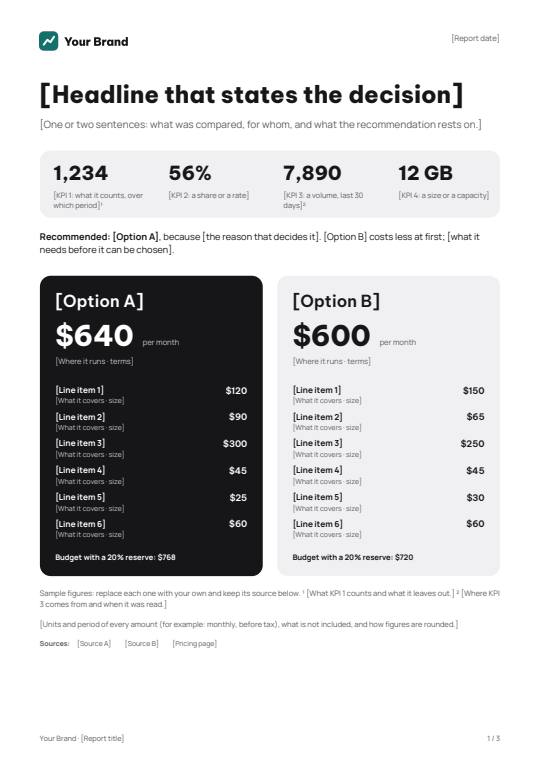

# Executive PDF report

A branded A4 report of two to four pages, generated in code with ReportLab from a `report.json`: a decision stated
in the headline, one band of key figures, two options compared side by side with their line items, how the cost
moves with scale, a projection, and every figure tied to a footnote and a clickable source. A layout check records
every text box to catch overflows, and the text is read back out of the finished PDF.



## When to use it

When a partner, a client or a board has to choose between options and needs the numbers on one page: a provider or
plan comparison, an infrastructure or pricing decision, a budget with a projection. It is not a long-form document:
each page answers one question, and everything that does not change the decision goes to a footnote.

## The design

| Element | Recipe |
|---|---|
| Header | Logo top left (26 pt tall), report date top right in the muted colour. |
| Title | Display face, extra bold, 26 pt, one line (it shrinks to fit, never wraps). It states the decision, not the topic. |
| Lead | One or two sentences, 11 / 16 pt, muted: what was compared, for whom, on what it rests. |
| Key figures | A soft rounded band (tonal surface, no border) with 2–4 KPIs: value 21 pt display, label 8.2 pt muted, footnote markers ¹ ² on the labels. |
| Recommendation | One paragraph, the choice in bold first, then the trade-off. |
| Comparison | Two cards of the same height, the recommended one dark (ink background, white text) and the other light (tonal). Title, the total in 31 pt, the unit next to it, where and on what terms, then line items with a short detail under each and the price right-aligned, and a reserve line at the bottom. Totals are summed from the items. |
| Tables | Zebra rows on soft rounded bands, prices right-aligned in the title weight, optional group headers centred over their columns, bold rows for "today" and totals; compact tables (15.8 pt rows) for detail; a soft band marks projected rows. |
| Before you decide | Three short columns: a prerequisite, a risk to control, how to validate. |
| Chart | One line: observed points solid in ink, projected points dashed in grey, the value over every point, a faint grid, a caption on each side. |
| Footnotes and notes | 8–8.5 pt muted, right under what they explain, on the same page as their markers. |
| Sources | A row of clickable labels (link annotations), muted. |
| Footer | Running title left, "n / N" right, 8 pt muted. |

Rules of the line: tonal surfaces and space separate things (no boxes inside boxes, no rules except the chart grid);
one radius (12 pt) everywhere; text in normal case and normal tracking; grays stay neutral; 44 pt margins.

## Writing rules

- The headline states the decision; the lead says what was compared, for whom, and on what the choice rests.
- One number, one definition: every KPI and every total has a footnote that says what it counts, what it leaves
  out and when it was read ("active" is not "paying"; an equivalent cost is not an invoice).
- Every amount carries its unit and period (monthly, before tax, rounded) and what is not included.
- Separate what was measured from what is projected (solid and dashed, plain rows and a band), give the growth
  assumption in one sentence with its range, and never present a design budget as proven capacity.
- Link every source; prefer the provider's official pricing page and the date it was read.

## Format

| | |
|---|---|
| Page | A4 portrait (595 × 842 pt), 44 pt margins, content between 88 pt and 790 pt from the top |
| Length | 2 to 4 pages; page breaks are explicit in `report.json` (overflows are reported, never reflowed) |
| Fonts | Display: Be Vietnam Pro 800 and 600; body: Manrope 400 and 700 (static TTFs, embedded as subsets) |
| Output | `<piece>/renders/<meta.filename>`, metadata title, author and subject set, clickable source links |
| Builds | Reproducible: the same `report.json` gives the same bytes (`"reproducible": false` in `meta` stamps the real creation time) |

## Build the sample

From the repository root:

```sh
python3 -m venv benches/pdf-report/.venv
benches/pdf-report/.venv/bin/pip install -r benches/pdf-report/requirements.txt
(cd benches/pdf-report && npm install)                         # only for the logo (headless Chromium)
core/bin/fetch-fonts.sh "Be Vietnam Pro:600,800" "Manrope:400,700"

P=benches/pdf-report/samples/decision-report
node benches/pdf-report/engine/render.mjs $P logo              # brand/logo.svg → brand/logo.png
node benches/pdf-report/engine/render.mjs $P pdf               # PDF + layout check + read-back + page PNGs
node benches/pdf-report/engine/render.mjs $P poster            # page 1 → $P/renders/poster.png
node benches/pdf-report/engine/render.mjs $P poster --out benches/pdf-report/docs/poster.png   # the bench's own poster
```

Outputs: `$P/renders/decision-report.pdf` and, in `$P/renders/qa/`, `layout-check.json`, `readback.txt`,
`readback-check.json` and `page-1.png` … `page-3.png`. Without the logo step the header draws a placeholder lockup
in vector; without the fonts Helvetica stands in (with a warning) and the layout check still runs.

## Make your own

1. Copy the sample folder anywhere (`cp -r benches/pdf-report/samples/decision-report work/q4-hosting`) and edit its
   `report.json`; add a `brand.json` next to it to override the bench brand for that report only.
2. Write page by page. Each page has `blocks`, then optional `sections` (`{ "heading", "heading_size", "blocks" }`:
   a heading followed by its blocks); everything flows from the top. The block types and their options are at the
   top of `engine/blocks.py`:

   | Block | Options |
   |---|---|
   | `title` | `text`, `size` |
   | `lead` | `text` |
   | `heading` | `text`, `size` |
   | `paragraph` | `text` (`<b>`, `<br/>`), `size`, `muted` |
   | `metrics` | `items[] { value, label, note }` |
   | `comparison` | `cards[] { theme: dark \| light, title, price: "sum" \| number, unit, meta, items[] { title, detail, price }, footer }` (`{total*1.2}` in the footer) |
   | `table` | `columns[] { label, width, align, format: money \| raw }`, `groups[] { label, from, to }`, `rows`, `zebra`, `band_from`, `bold_rows`, `compact` |
   | `columns` | `items[] { title, body }` |
   | `chart` | `labels`, `values`, `projected_from`, `y_max`, `grid`, `caption_left`, `caption_right`, `height` |
   | `footnotes` | `items[]` (start each with its marker: `¹ …`) |
   | `note` | `text` |
   | `sources` | `label`, `links[] { label, url }` |
   | `spacer` | `height` |

   Every block takes `gap` (points above it). `meta.currency` sets the money format (`symbol`, `thousands`,
   `decimal`, `decimals`, `position`), so `1.234,56 €` and `$1,235` come from the same data.
3. Build with `node benches/pdf-report/engine/render.mjs <piece> pdf --strict` until it reports "clean", then open
   the page PNGs and look at every page: the check proves the boxes fit, not that the page reads well.

## The QA pass

`layout-check.json` lists every text box (page, position, size, font, the block and the card or cell it belongs to)
and the problems found:

- text outside the page margins, or outside its card, KPI cell or table cell;
- two text boxes that overlap (a detail that wrapped into the next line item, a title running into its price);
- a page whose content runs past the footer line;
- characters the font does not have (they would print as blanks);
- a footnote marker without its note on the same page, or a note nobody references;
- a page count outside 2–4.

The read-back extracts the text of the finished PDF (pypdfium2) and looks for every string that was drawn: a missing
glyph, a clipped paragraph or text hidden under a shape shows up as a string that cannot be found. It also checks
that every source link became a link annotation. `--strict` makes any finding fail the build.

## Review checklist

- [ ] `render.mjs <piece> pdf --strict` reports "clean".
- [ ] Each page answers one question; the headline is the decision.
- [ ] Every figure has a definition, a unit and period, and a source; no sample figure is left.
- [ ] Totals equal the sum of their line items; the same number has the same value on every page.
- [ ] Measured and projected values are visibly different; the assumption and its range are stated.
- [ ] Every link opens the right page; the date in the header is the date of the data.
- [ ] The page PNGs read well at 100% and printed; nothing is cramped against a card edge.

## Rebrand

1. `brand/brand.json` (or a `brand.json` in the piece): colours (`ink` text and the dark card, `muted` secondary
   text, `accent` the placeholder logo), fonts (`display`, `body`) and the `pdf` block: `weights` for the four roles
   (display 800, title 600, body 400, bold 700), `soft` (bands and the light card), `zebra`, `grid`, `projected`,
   `on_dark_muted`, `radius`, `margin`, `logo_png`, `logo_height`.
2. Fonts: any Google Fonts pair, fetched with `core/bin/fetch-fonts.sh "Display Family:600,800" "Body Family:400,700"`.
   ReportLab embeds TrueType outlines only: use the static TTFs that script downloads, not variable or CFF fonts.
3. Logo: put your SVG in `logo.wordmark` and run the `logo` mode; live `<text>` in the SVG is rendered with the
   brand font (embedded from the fonts folder). Or drop your own `brand/logo.png`. With neither, a placeholder
   lockup is drawn.

## Lessons

- Draw with a handful of helpers (`rect`, `text`, `right`, `para`, `link`, `money`) and record every text they draw:
  the record is what makes an automatic layout check possible.
- A structural check is necessary and not sufficient: render the pages and look at them, every time.
- Read the text back from the PDF: it catches the glyph the font lacks before a reader does.
- Format money in one place from the report's currency settings, rounded, never by hand in the copy.
- Keep page breaks in the author's hands; a report that silently reflows moves a footnote away from its figure.
- Footnotes carry the honesty of the report: what a number excludes, what is an estimate, what is not proven.

## Files

```
engine/render.mjs     entry point: pdf | logo | poster
engine/report.py      builder: header, blocks, footer, layout check (python engine/report.py <piece> [--strict])
engine/design.py      tokens from brand.json, page helpers, money formatting, footnote markers
engine/blocks.py      block renderers and their options
engine/qa.py          text read-back, page PNGs, poster
tools/render_logo.mjs SVG → PNG with headless Chromium and the brand font
brand/                brand.json and the placeholder logo SVG
samples/decision-report/report.json   the empty guiding report
requirements.txt      reportlab, pypdfium2, pillow
```

## Credits

[ReportLab](https://www.reportlab.com/opensource/) (BSD), [pypdfium2](https://github.com/pypdfium2-team/pypdfium2)
(Apache-2.0 / BSD-3-Clause), [Pillow](https://python-pillow.org) (MIT-CMU), [Playwright](https://playwright.dev)
(Apache-2.0). Fonts: [Be Vietnam Pro](https://fonts.google.com/specimen/Be+Vietnam+Pro) and
[Manrope](https://fonts.google.com/specimen/Manrope), SIL Open Font License.
