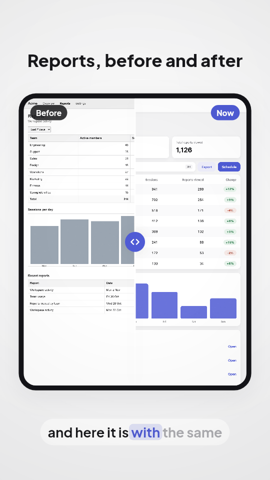

# Progress report video

A short vertical video that tells partners or stakeholders what reached the product in production this week: the
brand opens, one real number, the same screen before and after with the same data, the big feature explained,
a quick list of the rest, and the brand closes. A shorter "update" variant covers what happened between two
weeklies. Everything is drawn in code at 60 fps from real captures of the product, timed to the narration.



## When to use it

- **Weekly**: every Monday, covering the previous seven days (Monday to Monday). One to two and a half minutes.
- **Update**: between weeklies, short (20 to 45 seconds), only what the last weekly did not cover. Its window starts
  where the last video ended, and its hook is closing what that video left pending ("in review" then, "live" now).

It is not an ad: it speaks to people who already know the product and want to see that it moves. It works for
investors, partners, a board, internal all-hands, or customers who follow a changelog.

## The recipe

### Structure

| # | Section | What it does | Typical length |
|---|---|---|---|
| 1 | `opening` | The mark resolves (tile pops, the glyph is drawn by a clockwise sweep, a small settle), slides into the lockup with the wordmark, and the title of the piece rises: "Weekly update", the window under it. | 4–5 s |
| 2 | `metric` | ONE headline number from production, rolled in like an odometer while it is said, landing on the last word of the number; its comparison chip, a short trend drawing itself, and where the number comes from. | 6–9 s |
| 3 | `beforeAfter` | The same screen with the same data: the old build first ("Before"), then a divider sweeps across on the narration, stops halfway so both can be compared, and finishes on "Now". Then the camera moves onto each change as it is named, with a ring, a spotlight or a magnifier and a short label. | 9–14 s |
| 4 | `feature` | The big feature: its icon and name arrive big, glide up into the title, the steps build up on the words that name them (joined by a flowing line), then the real screen rises in and the camera finds the new control. | 12–18 s |
| 5 | `list` | The rest of the week, one row per change, each arriving on its word with its check drawing in. Three to five items. | 5–8 s |
| 6 | `close` | The previous section shrinks into the mark, the mark finishes and settles into the lockup, one line and the address rise in; a slow push holds to the last frame. | 4–6 s |

The update variant uses `opening` (a short sting), `status` (the pending item flips to live on its word),
`screen` (one capture with focus) and `close`.

### Narration

- **Impersonal**: "These are the improvements that reached the platform this week", "A saved view is chosen". No
  team names and no second person, in the voice or on screen. Passive and impersonal forms carry "how it works".
- **Only what is live in production** (or approved by a provider: a public store listing, a console). Every claim
  in the script points at an entry of `evidence/claims.json` with something checkable: a commit, a deploy log line,
  a release tag, a ticket, a read-only query. Pending work can be mentioned only as pending.
- **Complete sentences.** A requested duration is a guide: a natural ending beats a sentence cut to fit.
- Numbers are written as words in the script (the captions come from the voice alignment); the screen shows digits.
- One idea per line; each visual beat is anchored to a word of the line that says it.

### Picture

- **Camera**: no screen ever sits still. Every screen section has a slow push-in for its whole length (about 5%),
  and the camera moves onto each focus target (zoom 1.1–1.45) as the narration names it, keeping a zoomed device
  edge to edge. Easing is a fast start with a long soft landing; moves last 0.5–0.8 s.
- **Transitions come from the logo**: `iris` opens the next section through the mark's silhouette, growing from where
  the mark sits like an app icon opening (tile colour first, then the section fades in inside it); `iris-close`
  shrinks the last section into the mark of the close; `sweep` is the mark's clockwise resolve at frame scale with
  an accent hand; `tile` crosses the frame with a brand-colour panel that has the glyph cut out. `fade` and `cut`
  exist for the rare case. A transition is centred on the section start and lasts 0.7 s.
- **Typography**: the brand display face for titles, numbers and captions; the body face for labels and footnotes.
  Normal case, normal tracking, one line per title (it shrinks to fit). Sizes are relative to the frame width.
- **Colour**: the brand background with a soft light from above; tonal cards with soft shadows (no outlines); the
  accent for rings, markers, the divider handle, the trend and every transition; positive and negative only for
  comparisons and status.
- **Highlights on narrated words**: captions show the whole chunk in a quiet tone and turn each word to ink as it is
  said, with a soft accent marker gliding under the current word; *emphasis* words stay in the accent. On screens,
  rings, spotlights and magnifiers land on the exact element the narration names (found by its text in the capture).
- **Captions**: up to seven words per chunk, two lines at most, never ending on a small word; off during the opening
  and the close (the screen already says it).
- **End card**: the lockup, one line and the address, held 2–3 s with a slow push.

## Audio recipe

- **Voice**: one narrator with the accent of the audience. Cast by audition: shortlist library voices, record 2–3
  takes per line, keep the takes that say every word, end every sentence and are never whispered, then let your ear
  (optionally an audio LLM judge in blind shuffled rounds) choose among them (`tools/audition.py`). A confident,
  warm, matter-of-fact read at a slightly brisk speed (1.0–1.1) suits it.
- **Music**: composed over the timeline sections, audible under the voice like a commercial bed: intro on the logo,
  build on the metric, main on the screens, lift on the big feature, back to main for the list, outro with a final
  chord on the close. The workbench writes it procedurally (`style: pulse`), or with a music API (see core).
- **Effects** come from the picture (`render.mjs events`): the logo sting, whooshes on transitions, a swoosh when the
  number rolls and a ding when it lands, swooshes on the divider, pops on rings, steps and list items.
- **Mix**: voice in front, music ducked about 10 dB under it, effects tucked under the voice, master at −14 LUFS
  with true peak ≤ −1 dBTP checked after AAC encoding. Then read the master back with a transcription
  (`tools/transcribe_master.py`): every line must be heard intact.

## Format

| | |
|---|---|
| Frame | 1080 × 1920, 60 fps master (`script.format`); previews at 540 × 960, 30 fps |
| Video | H.264 High, yuv420p, CRF 18, preset slow (previews CRF 23) |
| Audio | AAC 256 kb/s, 48 kHz, −14 LUFS integrated, true peak ≤ −1 dBTP |
| Captures | 1024 × 1320 CSS px at 2× (2048 × 2640 PNG), frozen clock, read-only |
| Length | weekly 1:00–2:30, update 0:20–0:45 |
| Name | `<Brand> - <title>.mp4` |

## Render the sample

From the repository root. The sample is a placeholder week for "Acme Platform" with mock screens; silent voices
need no keys.

```sh
(cd benches/progress-report-video && npm install)
core/bin/fetch-fonts.sh "Plus Jakarta Sans:500,600,700,800" "Inter:400,500,600,700" "JetBrains Mono:500"
bash benches/progress-report-video/samples/acme-week/make-screens.sh         # before/after captures (headless)

P=benches/progress-report-video/samples/acme-week
WB_TTS_PROVIDER=silent core/bin/wb voice $P && core/bin/wb timeline $P
node benches/progress-report-video/engine/render.mjs $P check
node benches/progress-report-video/engine/render.mjs $P still 1.2,9,17,23,31,37,42,49
node benches/progress-report-video/engine/render.mjs $P events
core/bin/wb music $P && core/bin/wb mix $P
node benches/progress-report-video/engine/render.mjs $P preview
core/bin/wb verify $P/renders/preview.mp4 --size 540x960 --fps 30
node benches/progress-report-video/tools/check-claims.mjs $P
```

The update variant: `P=benches/progress-report-video/samples/acme-week-update` and the same commands from `wb voice`
(it reuses the weekly's captures). Outputs land in the piece: `renders/stills/`, `renders/preview.mp4`.

## Make your own week

Start a piece from the sample (copies script, film, evidence and the capture manifest):

```sh
core/bin/wb new progress-report-video acme-2026-11-09 --dest work
P=work/acme-2026-11-09
```

1. **Research first, in parallel**: merged commits and the deploy log of the window, release notes, tickets, team
   chats and meeting notes, AI coding session logs, store consoles. Keep only what is in production or approved by a
   provider. Write `evidence/claims.json` (one claim per fact, each with its evidence) before writing a line.
2. **Script** `script.json`: one line per idea, numbers in words, `claims` on every line (`[]` for brand lines),
   `slot` notes until it is done. `node benches/progress-report-video/tools/check-claims.mjs $P` catches second
   person, team names, cut sentences, unknown or unproven claims.
3. **Screens, before and after.** Rebuild the old front from a commit without touching the repository, serve both
   builds against the same read-only data, capture both the same way:
   ```sh
   T=benches/progress-report-video/tools
   BEFORE=$($T/build-front-at-commit.sh ~/code/app v4.2.0 --build "npm ci && npm run build" --dist dist --env readonly.env)
   AFTER=$($T/build-front-at-commit.sh ~/code/app main --build "npm ci && npm run build" --dist dist --env readonly.env)
   node $T/serve.mjs "$BEFORE" --port 4411 --spa &  node $T/serve.mjs "$AFTER" --port 4412 --spa &
   node $T/capture.mjs $P/shots.json --var BEFORE=http://127.0.0.1:4411 --var AFTER=http://127.0.0.1:4412
   ```
   `readonly.env` points both builds at the same API with read-only credentials (or a replica); `capture.mjs` also
   aborts every write request, freezes the clock and blocks other hosts. Use a demo account or `hide` selectors so no
   real person, customer or account appears. Same viewport, same data, same scroll for both builds.
4. **Film** `film.mjs`: the sections and their anchors (see the reference below). `render.mjs $P check` resolves
   every anchor, element and capture.
5. **Voices by audition**: `core/bin/wb voice $P --takes 3`, then
   `.venv/bin/python benches/progress-report-video/tools/audition.py $P --judge gemini` (or `openai`, or `none`),
   listen to the chosen takes, rewrite any phrase the voice keeps distorting, then `core/bin/wb timeline $P`.
6. **Review frames** one at a time, in order, and around every transition:
   `node benches/progress-report-video/engine/render.mjs $P still <t1,t2,…>` (a contact sheet, `sheet 0:60:2`, is only
   for an overview: it hides the jump between two frames).
7. **Sound**: `render.mjs $P events`, `core/bin/wb music $P`, `core/bin/wb mix $P`, then `render.mjs $P preview` and
   listen end to end.
8. **Master and checks**:
   ```sh
   node benches/progress-report-video/engine/render.mjs $P final
   core/bin/wb verify $P/renders/final.mp4 --fps 60
   .venv/bin/python benches/progress-report-video/tools/transcribe_master.py $P
   node benches/progress-report-video/tools/check-claims.mjs $P --strict
   ```

## Section reference

Every section takes `from` (the anchor where its narration starts; the first section starts at 0), optional `lead`
(seconds before the anchor, 0.3), `transition` (into it) and `transitionDur` (0.7), and `captions: false`. Anchors:
`'L03'`, `'L03:end'`, `'L03:word'`, `'L03:word#2'`, `'L03:word:end'`, any of them `+0.4` / `-0.2`, `'end'`, or seconds.
The full option list of each type is at the top of its file in `engine/scenes/`.

| Type | Main options |
|---|---|
| `opening` | `title`, `subtitle`, `lock` (s after the start when the mark completes) |
| `metric` | `label`, `value`, `format { sep, decimals, prefix, suffix }`, `countAt`, `landAt`, `delta { text, tone, at }`, `series`, `seriesLabels`, `source` |
| `beforeAfter` | `title`, `before`, `after` (capture ids), `revealAt`, `hold`, `labels`, `frame` (`tablet` · `browser` · `none`), `focus[]` |
| `screen` | `title`, `capture`, `frame`, `focus[]` |
| `feature` | `title`, `icon`, `tagline`, `heroAt`, `steps[] { icon, title, detail, at }`, `screen { capture, at, focus[] }` |
| `list` | `title`, `items[] { text, icon, at }` |
| `status` | `title`, `icon`, `detail`, `was`, `now`, `flipAt`, `note` |
| `close` | `line`, `url`, `lock` |
| `custom` | `draw(c, sec, t, film)`, optional `prepare`, `events` |

`focus[]` items: `{ at, to, el, kind: 'ring' | 'spot' | 'magnify', label, zoom }`. `el` is the element's visible text
(`'Export'`), `{ text, n, role, box: true }` (box: the card or button that contains the text), an array of those (the
box around all of them) or a rect in CSS px. Icons (`engine/lib/icons.mjs`) are Lucide stroke icons by name.

## Review checklist

- [ ] Every line is backed: `check-claims.mjs --strict` passes; nothing in the video is pending, staged or flagged off.
- [ ] No second person and no team names in voice, captions or screens; no real customer, account or person in captures.
- [ ] Before and after show the same screen, viewport, scroll and data; the old build really is that commit.
- [ ] The metric is a single number with its definition, comparison and source; the digits match the words said.
- [ ] Each ring, spotlight or magnifier lands on the element the narration names, at the word that names it.
- [ ] No frame sits still (push-ins everywhere); transitions start on the mark and read clearly.
- [ ] Captions: chunks never end on a small word, emphasis matches the script, nothing overlaps the device badly.
- [ ] Voice: every sentence ends naturally, no whispered take, the accent fits the audience.
- [ ] Music is audible between sentences and never covers a word; the master reads back intact.
- [ ] `wb verify`: 1080 × 1920, 60 fps, −14 LUFS ± 1, true peak ≤ −1 dBTP, no black or frozen stretch, content on frame one.
- [ ] Frames reviewed one by one around every transition and focus move, on a phone at least once.

## Rebrand

1. `brand/brand.json`: name, tagline, url, colours, fonts, radius (or a `brand.json` inside one piece). Colour roles:
   `background` frame, `surface` cards and captions, `ink` text, `muted` labels and footnotes, `accent` rings,
   markers, handle, trend and transitions, `accent_ink` text and icons on the accent, `positive` / `negative`
   comparisons and status.
2. Fonts: any Google Fonts family, fetched with `core/bin/fetch-fonts.sh "Family:500,600,700,800"` (display) and the
   body family; missing fonts fall back to a system sans with a warning.
3. Logo: `brand/logo-mark.svg`. For the tile/glyph animation, export the mark as flat shapes (rect, circle, path,
   polygon) with `fill` and `stroke` attributes and no transforms, styles, masks or gradients; the first shape that
   covers most of the viewBox is treated as the tile. Any other SVG works too, animated as a whole. A wordmark SVG
   (`logo.wordmark`, outlined text) replaces the name set in the display face.
4. Mock screens in the sample (`samples/acme-week/mock-front`) only demonstrate the method; replace them with
   captures of your product.

## Lessons from producing these

- Research before writing, and in parallel: the deploy log and the merged commits decide what can be said; chats,
  meetings and session logs explain why it matters. A claim without a checkable trace does not go in.
- Rebuilding the old front from a commit (`git archive`) beats hunting old screenshots: same data, same viewport, no
  repository or server touched. Point the old build at the same read-only data as the new one.
- Freeze the clock and the data for captures, block every outbound request except fonts, and capture at 2× so a
  push-in on a button stays sharp.
- Crop or hide whatever identifies an account, a customer or a person in admin and billing screens.
- Never let a screen sit still; a slow push-in is enough. Look at frames one by one, in order and around each
  transition: a contact sheet hides the jump between two frames.
- The brand opens and closes the piece, and its mark gives every transition; nothing else needs decorating.
- Voices: tags that lower the voice ("close", "intimate", "softly", "whispers", "sheepish") produce whispers, and
  audio judges do not hear them; measure the voicing of every take and regenerate. Use neutral directions
  ("confident", "matter-of-fact", "sincere").
- An accent set by a direction prefix can vanish with a model upgrade: one model version kept it, the next sounded
  neutral. Re-audition when the model changes.
- Audio judges favour takes by the order they hear them: vote blind over several shuffled rounds, with a time limit
  and a cache per take.
- Some words come out distorted in synthetic voices; rewrite the phrase instead of fighting the take.
- Music must be audible like in a commercial, about 10 dB under the voice; check that a generated track is not
  silent before mixing (it happens).
- Read the master back with a transcription: it catches the word a sound effect or the music covered.
- Keep heavy outputs (renders, takes, captures, mixes) out of git; keep the evidence and the scripts in.

## Files

```
engine/render.mjs           entry point: check | still | sheet | events | preview | final | poster
engine/lib/                 film assembly, frame, timeline anchors, brand and fonts, logo, transitions,
                            captions, screens (captures, device, camera, highlights), icons, math, drawing
engine/scenes/              opening, metric, screens (beforeAfter, screen), feature, list, status, close
tools/build-front-at-commit.sh   export (and build) any repo at any ref with git archive, print the folder to serve
tools/serve.mjs             static server on 127.0.0.1 with a read-only /api fixture mount
tools/capture.mjs           URL list → PNG + element map (text, role, box), headless, frozen clock, read-only
tools/check-claims.mjs      claims, evidence, impersonal copy, complete sentences
tools/audition.py           voice casting by audition (fidelity, endings, whispers, blind judge)
tools/transcribe_master.py  read the master back line by line
brand/                      brand.json and the placeholder mark
samples/acme-week/          weekly sample: script, film, evidence, mock fronts, shots.json, make-screens.sh
samples/acme-week-update/   update sample: script, film, evidence
```

Environment (all optional; see the repository's `.env.example`): `WB_VOICE_NARRATOR` and `ELEVENLABS_API_KEY` or
`OPENAI_API_KEY` for voices, `OPENAI_API_KEY` for transcripts and the OpenAI judge, `GEMINI_API_KEY` for the Gemini
judge, `WB_TRANSCRIBE_MODEL` (one transcription model for word timings and read-backs; it must return word
timestamps), `WB_JUDGE_OPENAI_MODEL`, `WB_JUDGE_GEMINI_MODEL` to change models, `WB_FONTS_DIR` for another fonts
folder, `WB_DEBUG=1` for stack traces.

## Credits

Icons: [Lucide](https://lucide.dev) (ISC License). Rendering: [@napi-rs/canvas](https://github.com/Brooooooklyn/canvas)
(Skia). Captures: [Playwright](https://playwright.dev). Fonts: [Plus Jakarta Sans](https://fonts.google.com/specimen/Plus+Jakarta+Sans),
[Inter](https://fonts.google.com/specimen/Inter) and [JetBrains Mono](https://fonts.google.com/specimen/JetBrains+Mono), SIL Open Font License.
