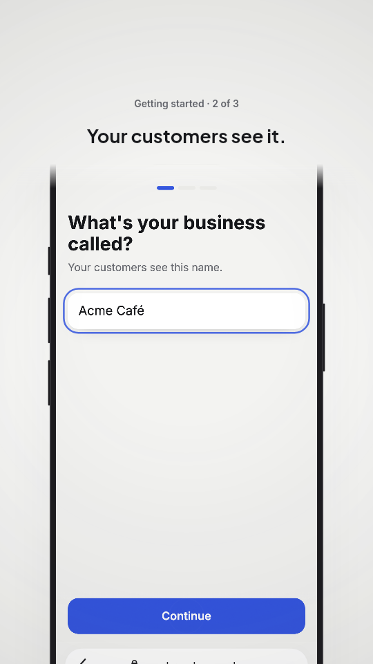

# Story highlights

Packs of short vertical stories for the highlights of a profile (Instagram, WhatsApp, Facebook): a topic, two or three stories that each teach one thing and connect seamlessly, one music bed across the whole pack, the brand close only at the end of the pack, a round cover for each highlight, and one reel that joins the pack. Each story is a tutorial on real screens of your app, built on the kit of `benches/app-tutorial`.



## When to use it

- A topic people come back to on your profile: getting started, how bookings work, connecting an account, why your product.
- Content that is too long for one story but splits into steps: each story teaches one step and leads into the next.
- Also a single highlight story (a pack of one is its own reel). For a one-off tutorial in the feed, use `app-tutorial`.

## The recipe

### A pack

| Rule | Why |
|---|---|
| 2–3 stories per pack, up to about 45 s each; split only where a step ends. | People tap through highlights; long stories get skipped, too many stories get abandoned. |
| Each story teaches one thing, opens with its topic in the first second, and ends with a bridge to the next ("Next, you set up your business"). | Someone who opened the highlight already chose the topic: the hook is the promise that in a few seconds they will know how. |
| Story N+1 opens on exactly the frame story N ended on (`pack.carry()`): same screen, same camera, same drift. | The pack reads as one continuous tutorial, and the reel has no visible seams. |
| The same demo business, people and data in every story and every pack. | Highlights read as chapters of one product, and the screens agree with each other. |
| The brand close only in the last story of the pack. | A logo every 15 seconds is noise; one close at the end is a signature. |
| A small header "Pack · n of N" above the captions; left out of the reel version. | It tells the viewer where they are while tapping; in the reel it would be wrong. |
| One music bed for the whole pack, sliced per story. | Alone, each story has its music; in the reel the music never restarts at a join. |
| Short tails (1.4 s) except the last story (about 4 s for the close). | The next story arrives quickly; the close gets its time. |

### A story

Everything in the `app-tutorial` recipe applies (phone, camera push-ins on the named control, taps on the action word, rings, word-synced captions, safe zones). Story layout: header at y 300, captions at y 392, phone top at y 572. Stories and reels share one safe zone: keep content between y 270 (stories show progress bars and the account there) and y 1440 (the reel's caption).

### Covers

One 1080 × 1920 image per pack: the brand colour and one white line icon, centred (profiles show the central circle). Ordinary icons from a good icon set read best; the bench draws a few generic ones (`user-plus`, `calendar`, `chat`, `link`, `star`, `bell`, `wallet`, `question`) and accepts any 24 × 24 SVG. `profile-preview.png` shows the row as a profile will.

### Reel

The stories in order, joined by a 0.3 s upward wipe with an audio crossfade, set to −14 LUFS with true peak at or under −1 dBTP measured after encoding. It uses each story's reel version (rendered with `WB_REEL=1`: no header).

## Audio

- **Voice.** One brand voice for every story of every pack, at full voice, friendly and direct; slightly more measured than an ad (tempo 1.0–1.05), with pauses after each step. Never whispered.
- **Music.** `tools/pack_music.py` composes one bed as long as the reel with `core/bin/wb music` (style of the first story: `"tutorial"`, about 100 BPM, `level: -22`, `duck: -6`) and gives each story its slice with a 0.25 s fade-in; the arc runs over the whole pack (on the beat at once, under the voice, a small lift before the end, a resolved chord under the close).
- **Effects.** `tap` on taps, `typing` while text fills in, `whoosh` on page changes; the close adds `whoosh` and `logo`.
- **Loudness.** Every story and the reel at −14 LUFS, true peak ≤ −1 dBTP.

## Format

Stories: 1080 × 1920, 30 fps, H.264 yuv420p BT.709, AAC 256 kb/s 48 kHz. Reel: the same, joined. Covers: 1080 × 1920 PNG.

## Production flow

From the repository root, after `(cd benches/app-tutorial && npm install)` and `(cd benches/story-highlights && npm install)`.

```sh
P=benches/story-highlights/samples/getting-started
node benches/app-tutorial/tools/capture.mjs --flow $P/capture.json      # captures shared by the pack: $P/captures/
python3 benches/app-tutorial/tools/lint_script.py $P/01-create-account --max-seconds 45
WB_TTS_PROVIDER=silent benches/story-highlights/tools/audio-pack.sh $P   # voices, timelines, one bed, effects, mixes
for s in 01-create-account 02-set-up 03-ready; do node benches/story-highlights/engine/render.mjs $P/$s check --social; done
node benches/story-highlights/engine/render.mjs $P/02-set-up still 0.5,3,6,10
benches/story-highlights/tools/render-pack.sh $P                        # final + reel version of every story, verified
python3 benches/story-highlights/tools/reel.py $P                       # $P/renders/reel.mp4, verified
node benches/story-highlights/tools/covers.mjs benches/story-highlights/samples   # $P/renders/cover.png + profile preview
python3 benches/story-highlights/tools/reel.py $P --deliver ~/Desktop/highlights   # numbered stories, the reel, the cover
```

A new pack: copy `samples/getting-started` (or `core/bin/wb new story-highlights my-pack`), edit `pack.json` (title, delivery folder, stories in order, titles, cover), the capture flow, and each story's `script.json` and `film.js`.

```json
{ "title": "Getting started", "folder": "1 · Getting started",
  "stories": ["01-create-account", "02-set-up", "03-ready"],
  "titles": ["Create your account", "Set up in three steps", "You're ready"],
  "cover": { "icon": "user-plus", "name": "Start" }, "extras": ["renders/cover.png"] }
```

A story's `film.js` is a tutorial film (see `benches/app-tutorial/README.md`) with `pack` in its API:

```js
module.exports = ({ W, L, focus, pack }) => {
  const start = pack.carry();                 // the frame the previous story ends on
  return {
    shots: [{ at: 0, ...start.shot }, /* … */],
    phone: [{ t: 0, ...start.phone }, /* … */],
  };
};
```

`pack.number`, `pack.total`, `pack.isFirst`, `pack.isLast`, `pack.title`, `pack.titles`. The end card is on by default only in the last story; `header: false` (or `header: { until: 3 }`) controls the header per story.

## Review checklist

- [ ] Each story makes sense alone: topic in the first second, one thing taught, result on screen at the end.
- [ ] The last frame of each story and the first frame of the next are the same frame (look at both).
- [ ] Data agree across stories and packs: same business, same names, same prices.
- [ ] Header right on every story ("n of N"), absent from the reel.
- [ ] The brand close appears once, at the end of the pack.
- [ ] `check --social` clean on every story; nothing between y 0–270 or below y 1440 that matters.
- [ ] Music continuous across the reel joins; voice full and clear in every line.
- [ ] Every story and the reel pass `wb verify`.
- [ ] Covers read as a row in `profile-preview.png`; names are short (profiles cut long names).

## Rebrand

`brand/brand.json` as in `app-tutorial`; a pack can override it with `<pack>/brand.json`. Capture your own app into `<pack>/captures/`. Covers take the brand accent unless `cover.color` says otherwise. Publishing tip: profiles usually order highlights by last update, so publish them in reverse of the order you want and leave the others untouched afterwards.

## Lessons from production

- Fewer, longer stories beat many short ones: two or three per highlight, up to about 45 s, split only where a step naturally ends.
- Direct, branded tutorials work for highlights: the brand speaks, shows the real screens and says "tap this, then this". Characters, sketches and jokes about other apps were rejected.
- Each story opens on its topic, and the screen must already show it: someone tapping through decides in a second.
- The brand close belongs at the end of the pack only; between stories it is an interruption.
- One music bed per pack, cut with the same offsets the reel uses, keeps the music continuous at every join. A generated track can come back silent: measure it before mixing.
- Continuity is mechanical, not hoped for: the next story starts from the previous story's last shot, camera and drift.
- Hide promotional lines that do not belong in an evergreen highlight (trial offers, prices) by covering them with the page colour (`mask`).
- Covers: plain brand colour and ordinary icons; hand-drawn or mascot covers read worse in the small circle.
- The reel version leaves out the per-story header; the reel joins with a short wipe and is levelled again as a whole.

## Files

```
benches/story-highlights/
├── README.md
├── package.json
├── brand/                     brand.json and a placeholder mark
├── docs/poster.png
├── engine/
│   ├── render.mjs             one story (every mode of the tutorial kit)
│   └── pack.js                pack.json, carry(), header, close only on the last story
├── tools/
│   ├── audio-pack.sh          voices, timelines, the pack bed, effects and mixes
│   ├── pack_music.py          one music bed sliced across the pack
│   ├── render-pack.sh         final and reel version of every story, verified
│   ├── reel.py                joins the pack, levels it, delivers it
│   └── covers.mjs             highlight covers and a profile preview
└── samples/getting-started/   pack.json, capture.json and three stories (script.json + film.js)
```
