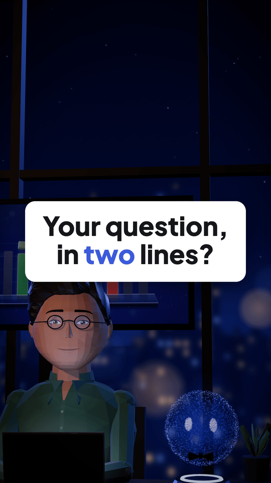

# Two-character studio

Short comedic or explanatory dialogues between two characters in a 3D night office: a stylised human **host** and an AI **orb** made of particles. A wall TV behind them shows the evidence (a post, a chart, a number, a screenshot), the camera cuts like cinema between planned shots, and the piece is delivered as one vertical HDR master. Everything is built in code with Three.js and rendered headless, frame by frame, so a new voice take re-times the whole film.



**Use it when** an idea fits a 25–35 second exchange: someone asks what the audience is wondering, the AI answers with the fact that changes the picture, the proof appears on the screen, and the AI lands a dry punchline. It suits explainers, myth-busting, product tips and news reactions. It does not suit long tutorials, lists or anything that needs more than two moments of on-screen evidence.

## Quick start

```bash
cd benches/two-character-studio && npm install && cd ../..          # three + Playwright (headless Chromium)
npx --prefix benches/two-character-studio playwright install chromium-headless-shell   # only if Chromium is missing
python3 -m venv .venv && .venv/bin/pip install -r core/requirements.txt -r benches/two-character-studio/requirements.txt
core/bin/fetch-fonts.sh "Plus Jakarta Sans:600,700,800" "Inter:400,500,600,700,800"   # the brand fonts (OFL), into assets/fonts/

P=benches/two-character-studio/samples/desk-dialogue
node benches/two-character-studio/engine/render.mjs $P still 1,6,12,25,32      # stills: works before any audio step
WB_TTS_PROVIDER=silent core/bin/wb voice $P && core/bin/wb timeline $P         # placeholder voices with real timing
node benches/two-character-studio/engine/render.mjs $P preview --t0 0 --t1 10  # short, silent, half-size SDR preview
```

Stills land in `$P/renders/stills/`, the preview in `$P/renders/preview.mp4`. Without a `timeline.json` the engine estimates timings from the text (14.5 characters per second), so you can frame shots before recording anything.

No GPU? Add `--gl swiftshader` to any render command: software WebGL works on any machine, about four times slower (0.4 s per half-size frame on a laptop CPU instead of 0.1 s).

## The recipe

### Story and structure
- **Duration:** 25–35 s including the silent tail. Estimate 2.3 spoken words per second, then measure with the real voices before directing.
- **Turns:** four to six, each a complete idea in one to three sentences, never a ping-pong of two-word lines.
- **Roles:** the host is the optimist who tries things and asks what the audience would ask; the orb brings reality: the fact, the limit, the source.
- **The hook is understood in the first 3 s:** the host's first line asks the question, and a title card in a white box can state it from frame 0.
- **Evidence:** at most two moments on the TV, each a concrete post, chart, number or screenshot, never a list or a title that repeats the line.
- **The frozen beat** (optional): the world freezes and greys out while the host gives the takeaway to camera; a fact card may appear. Nobody names it, and no text does.
- **The ending:** the orb's punchline, then a short silent wide shot that ends on a real frame. There is no call-to-action card and no fade to black.
- **Read every line for double meanings** before recording voices, and replace any line that has one.

### The characters (`cast.json`)
- **Host:** an anonymous stylised human built from primitives. The head has defined planes, and the eyes have an iris, a pupil, two catchlights and lids that follow the gaze. The mouth is driven by visemes, the jaw drops on open vowels, and the hair is a combed volume. He wears a shirt with a collar and rests his forearms on the desk, lifting a hand to gesture. Everything is a parameter: `skin`, `hair` (`style` swept / short / none, `color`, `sweep` side and amount), `eyes` (`iris`, `lid` crease / soft), `brows` (`arch`, `thickness`), `beard` (none / stubble / full), `shirt`, `collar`, `tie` (a colour or null), `mic`, `glasses` (`shape` round / square, `color`). Cast your own person; do not model a real one.
- **Orb:** a neutral AI made of about 4,000 particles on a thin spherical shell, over a faint inner core and a soft aura. Its colour comes from `brand.json` (`"color": "brand.accent"`). Two eye ovals of denser particles sit on its face while the shell keeps flowing around them; it blinks and looks around. Options: `particles`, `eyes` (glow / dark / none), `accessory` (`bowtie` or `none`), `bowtie` colour, and `body` (0–1: a dim inner sphere that keeps busy backgrounds from showing through the cloud; 0 keeps it a pure hologram).
- **Orb motion rules:** it never vibrates with the waveform and never shrinks. Its own voice level arrives through a critically damped follower and only swells the shell a few percent, brightens the glow and adds a slow ripple. Its gaze and hover are damped and slow. While it talks it plays partly to camera, so both eyes stay readable.
- **Props never pass through the orb**, and the two characters never overlap on screen (the QA checks it).

### The set
The bench ships one set, the night office below; `"city": "sunset"` in `cast.json` changes the view through the window, not the room.

- A night office: a big mullioned window over a procedural city (no photos), a desk with a black laptop with no logo, a mug, papers, a plant, the orb's dock with a glowing ring, an LED strip in the brand colour along the desk front, and a chair.
- **The wall TV** is panoramic (7.2 × 3.09 units) on a stand, with the city visible around it. By default it shows a bar chart over drifting particles: no text, no numbers and no logos, with four highlighted bars in the brand palette carrying small abstract 3D tokens. Evidence replaces it only during its own shot.
- **Light logic:** every light is motivated. There is a warm key from above, cool rims from the window, and the practical lights you can see (TV, dock ring, LED strip, laptop). Nothing lights the orb from below or the front.
- **Suspense pieces only:** an angled lamp over the orb (`"set": {"lamp": true}`); when it is on, the dock ring is off.
- A room-light event can drop the lights so that the orb's glow becomes the only light: `"events": [{"at": "L05:end", "room": 0.2, "fade": 0.4}]`.

**Adding a set.** The room is built by `makeSet(scene, o)` in `engine/page/set.js`; `engine/page/director.js` calls it, then places the wall TV (`TV_SCREEN` in `engine/page/tv.js`), the host at the desk (`DESK_Y`) and the orb on its dock (`DOCK`), and lights and animates the handles `makeSet` returns (`floorY`, `laptop`, `dock`, `dockRing`, `strip`, `city`). Write a second builder next to `makeSet` that returns the same handles, keep the characters' marks (`DESK_Y`, `DOCK`) and leave the TV's spot free, then choose the builder where the director calls `makeSet`, from a new key of `cast.json` `"set"`. The camera presets in `engine/page/cameras.js` are world positions aimed at those marks and at the TV: a set that keeps the marks keeps every preset; one that moves them needs its own presets, found on stills with `--camx` and each given its `frames` (who is in shot) for the QA and the shot plan.

### Camera and montage
| Rule | Why |
|---|---|
| The camera frames whoever speaks. One shot per turn, so a shot can carry two or three lines of the same speaker. | Long shots read as cinema; a cut on every line reads as a feed. |
| No shot under 2.0 s, most between 3 and 6 s (median ≥ 3.5 s); about 7–9 shots for 30 s. | Short shots are merged automatically, and the merged shot becomes a two-shot when it must hold both speakers. |
| Cuts land 0.10 s before the first syllable, never in dead air. | |
| Movement happens inside the shot: slow push-ins and dollies between two presets, with a quintic ease and a tiny handheld drift. | |
| **The TV focus:** the camera pushes in until the screen fills most of the frame with the bezel visible. It never enters the screen. The evidence sits on the screen's own particle background, legible for at least 2 s after the move, and the line plays as voice-over. | |
| **The TV changes content only on a cut.** | A screen that changes inside a shot reads as a second cut. |
| The frozen beat is one camera that creeps in slowly (`pause_wide` → `pause_wide_in`), with both figures in the lower half and room for a fact card above. The world is frozen; the picture is not. | A fully still frame reads as a frozen video to players and to delivery checkers. |

Presets (in `engine/page/cameras.js`, with who each frames):

| Framing | Presets |
|---|---|
| wide, two-shots | `wide`, `wide_in`, `two`, `two_in`, `two_low`, `two_low_in` |
| host | `host_med`, `host_med_in`, `host_cu`, `host_cu_in`, `host_high`, `host_high_in`, `host_side`, `host_side_in`, `host_ovr`, `host_ovr_in` |
| orb | `orb_cu`, `orb_cu_in`, `orb_ecu`, `orb_med`, `orb_med_in`, `orb_high`, `orb_high_in` |
| TV | `tv`, `tv_in`, `tv_focus`, `tv_focus_in` |
| frozen beat, cover | `pause_wide`, `pause_wide_in`, `cover` |

Try any preset on a still: `node engine/render.mjs <piece> still 5 --cam host_side`. Find a new framing with a free camera, `--camx px,py,pz,lookx,looky,lookz,fov` (for example `--camx 2.95,-0.40,15.5,1.40,1.55,1.0,34`), then add it to `cameras.js`.

### Text on screen: minimal and plain
- **Subtitles:** static white text with a thin dark outline and a soft shadow, so they read over any background without a box. They sit near the speaker's head without covering the face, and above the TV during evidence (`sub_pos` per camera in `direction.json`). Words in `*emphasis*` take the accent colour, lightened automatically until it reads on the night set. One subtitle at a time, and no karaoke.
- **Titles:** a centred white box with centred text in the display font, the keyword in `<em>` (accent colour).
- **Fact cards** during the frozen beat carry the fact only: no label, no numbering. The subtitle of a line a card `covers` hides while the card is up.
- **No** channel logos, tickers, name tags or "breaking" bars, and no CTA card at the end.

### Colour and HDR rules
- The scene is graded "HDR+": exposure ×1.7, colour +35%, knee at sRGB 0.93, soft shoulder from 650 nits, peak 1000 nits.
- **Light sources** (dock ring, LED strip, lamp, TV, city) come from a mask pass and may shine up to 1000 nits. Nothing else should pass ~430 nits.
- **Characters are protected** in the mask (white for the host, grey for the orb): no highlight expansion and a soft cap, 250 nits on the host (skin) and 400 on the orb. The orb may glow, but it never clips.
- **Text and graphics** are a separate 2D layer mapped at 300 nits, so subtitles never glare.
- Keep white props matte and a little darker (mug, papers): anything above the knee is expanded toward the peak.

## Audio recipe

- **Casting the human voice:** warm, natural, mid-tempo, a little playful, with natural breaths. In ElevenLabs terms that is stability ~0.45, style ~0.35 and speaker boost on, then `tempo` 1.06 (pitch-preserving, applied by `wb timeline`).
- **Casting the AI voice:** deep, calm, stoic and economical, the opposite of bubbly. Use stability ~0.7, style ~0.05 and speed ~0.95, then `tempo` 1.04 and the `robot` treatment (below). Cast a few candidate voices on the same 70-character line and keep the gravest one that does not dramatise.
- **Takes:** one per line with a fixed seed, or 3 takes to choose from (`wb voice <piece> --takes 3`, then edit `voice/selection.json`). Check every take for exact words before mixing.
- **Providers** through `core/bin/wb voice`: `elevenlabs`, `openai`, `cosyvoice` (local), `say` (macOS), `silent` (timing-only placeholders), or `auto`. Voice IDs come from `WB_VOICE_HOST` / `WB_VOICE_ORB` and keys from the environment, never from files.
- **Local voices instead:** [CosyVoice](https://github.com/QwenAudio/CosyVoice) clones a voice zero-shot from a 10–15 s reference clip on your own CPU. The core wraps it: install with `core/bin/install-cosyvoice.sh`, then give a voice `"provider": "cosyvoice", "reference": "voices/host.wav", "reference_text": "<exactly what the clip says>"` (or a ready `"profile": "….ps"`). Any other local engine or server works too: render one WAV per line as `voice/<id>__t0.wav`, run `benches/two-character-studio/bin/studio align <piece>` (word timings with faster-whisper, or estimated) and carry on with `wb timeline`. A recorded human voice follows the same path. Clone only voices you have permission to use.
- **The `robot` preset** (`tools/voicefx.py`, generic DSP, no model):
  - pitch −1 semitone with the formants preserved;
  - an octave-down shadow at 20% (low-passed at 1.8 kHz);
  - a 62 Hz amplitude ring at 12% and a 6/11 ms comb;
  - EQ: HPF 75 Hz, +2 dB at 140 Hz, −2 dB at 320 Hz, +3 dB at 2.6 kHz, +1.5 dB shelf at 9 kHz, LPF 11 kHz;
  - 2.5:1 compression and a small 55/90 ms room.

  `robot_light` skips the pitch work. It is set per voice with `"fx": "robot"` and applied by `studio prep` without changing the timing.
- **Music:** an original bed composed by code (`wb music`, style `ambient` or `tension`), quiet under the voice: `"level": -27` LUFS, ducked about 9 dB while anyone speaks, a tension cue under the hook and a lift near the end.
- **Sound effects** (`events.json`, rendered by `wb mix`): `plan.py` adds a pop under a title, a soft swoosh into each TV move, a tick at the freeze, paper under a fact card and a whoosh as the colour returns. Add your own cues per line (`"sfx": [{"at": "word", "name": "ding"}]`).
- **The frozen beat in sound:** the music is low-passed at 700 Hz and dipped 12 dB from the freeze to the colour return (or `"sound": "cut"` for silence), with 0.15 s crossfades. A faint room tone keeps the mix from dropping to digital silence.
- **Loudness:** −15.5 LUFS ±0.5 integrated with true peak ≤ −1 dBTP, measured **after** the limiter and again after the AAC encode. `wb mix` closes that loop (`"mix": {"lufs": -15.5}` in `script.json`). Normalising before the limiter lands about 0.6 dB short.

## Format

- **One MP4:** 1080 × 1920, **60 fps CFR** rendered for real.
  - HEVC Main 10 (`hvc1`), HLG transfer, BT.2020 primaries and matrix, limited range, graded HDR+.
  - AAC-LC 192 kbps at 48 kHz stereo, with `+faststart`.
- **Never above 60 fps:** phones and QuickTime play the middle of files of 85 fps or more in slow motion, even with the tag.
- **The Apple tag** `FullFrameRatePlaybackIntent = 1` is written by exiftool; it is harmless at 60 fps.
- **SDR fallback:** `final --sdr` delivers H.264 High BT.709 at the same size, rate and audio. The engine also falls back on its own:
  - with `libx265` missing, it uses `hevc_videotoolbox` (macOS);
  - with neither encoder, it delivers the SDR master and says so.
- No second "compressed" or "phone" copy: deliver the one master.

## Production flow (A → G)

```bash
P=path/to/your-piece           # start from a copy: core/bin/wb new two-character-studio my-piece
S=benches/two-character-studio/bin/studio
# A  script: lines, voices, music brief          -> edit $P/script.json (+ direction.json, cast.json)
# B  voices                                       -> core/bin/wb voice $P            (WB_TTS_PROVIDER=silent to time first)
core/bin/wb timeline $P                           # C  timeline.json: word timings, 50 Hz loudness envelopes
$S plan $P                                        # D  plan.json + events.json; read the shot list and its warnings
core/bin/wb music $P && $S prep $P && core/bin/wb mix $P   # E  music bed, orb treatment + frozen-beat sound, mix at -15.5 LUFS
node benches/two-character-studio/engine/render.mjs $P still 1,6,12,25 # F  look at stills of every shot before the long render
node benches/two-character-studio/engine/render.mjs $P final           # F  the master: renders/final.mp4
$S qa $P                                          # G  QA report + contact sheet in renders/qa/
core/bin/wb verify $P/renders/final.mp4 --fps 60 --lufs -15.5
node benches/two-character-studio/engine/render.mjs $P poster --out $P/renders/poster.png
```

`$S build $P` runs B to G in one go once the piece is written. Rendering is resumable: frames already on disk are skipped, and `--t0/--t1` re-render a stretch. The line check needs faster-whisper (optional: `.venv/bin/pip install faster-whisper`); its first run downloads Whisper's `small` model (about 500 MB) unless it is already cached. Without it, or with silent placeholder voices, the line check is skipped with a warning.

Disk and time: a 33 s master writes about 2 GB of temporary PNG frames (3D, 2D layer and light mask) in `renders/frames/<output name>/`, deleted at the end unless `--keep`; each output has its own folder, so two renders of one piece never collide. On a laptop GPU the frames take roughly 5–12 minutes, then the grade and the x265 encode a few more (`X265_PRESET=medium` for faster tests; the default `slow`, CRF 16, is the delivery setting). `--jobs N` sets the parallel pages (default 3 on a GPU, 2 in software).

## The files of a piece

`script.json` follows the workbench contract. This bench also reads:
- `voices.<v>.fx`: `robot` / `robot_light`;
- `voices.<v>.tempo`;
- `mix.lufs`: −15.5;
- `music.level` and `music.duck`;
- `format.fps`: 60.

Voices map to characters through `direction.json` → `speakers` (by default `host` → host and `orb` → orb; any other voice is an off-screen voice-over).

`direction.json`, everything optional:

```jsonc
{
  "speakers": { "host": "host", "orb": "orb" },
  "min_shot": 2.0,
  "lines": {
    "L01": { "cam": ["two_in", "two"],                                     // the shot that opens on this line: from A to B
             "host": [{ "tag": "brow_up", "at": "-0.1", "until": "end", "amp": 0.7 }],
             "gesture": [{ "hand": "right", "kind": "open", "at": "question", "until": "end+0.2" }],
             "look": [{ "who": "host", "target": "camera", "at": "+1.0", "until": "end" }],
             "sfx": [{ "at": "question", "name": "pop", "gain_db": -14 }] },
    "L02": { "orb": [{ "state": "pulse", "at": "-0.45", "until": "-0.05" }] },
    "L03": { "tv": { "cam": ["tv", "tv_focus"], "mv": 1.0,                 // a TV moment: its own shot, evidence on the screen
                     "evidence": { "kind": "post", "name": "Account Name", "handle": "@account · 2h", "text": "…", "caption": "Source · date" } } },
    "L05": { "join": true },                                               // no cut: the running shot carries this line
    "L06": { "insert": { "seq": [{ "kind": "image", "image": "evidence/shot.png" }], "zfrom": 0.3 } }   // full-frame insert, grown out of the TV
  },
  "titles": [{ "at": 0, "until": "L01:end", "text": ["Your hook,", "as a <em>question</em>?"], "y": 0.17 }],
  "pause": { "at": "L06", "through": "L06", "cam": ["pause_wide", "pause_wide_in"], "sound": "lowpass",
             "cards": [{ "at": "L06:takeaway", "until": "L06:end", "text": ["One takeaway,", "in plain words"], "covers": ["L06"] }] },
  "tail": { "cam": ["wide_in", "wide"], "lead": 0.35 },
  "events": [{ "at": "L05:end", "room": 0.2, "fade": 0.4 }],
  "sub_pos": { "host_med": 0.12 },
  "poster": { "cam": "cover", "title": ["Your question,", "in <em>two</em> lines?"] }
}
```

- **Anchors** (`at`, `until`): seconds, `"L03"` (the line's start), `"L03:word"` (the first word starting with it; `word#2` for the second), `"L03:end+0.3"`, `"L03:-0.1"` or `"dur-0.5"`. Inside `lines.L03` the line id can be omitted.
- **Evidence kinds:** `post`, `chart` (`title`, `subtitle`, `values`, `callout`), `number` (`value`, `label`) and `image` (`image`: a path inside the piece).
- **Host tags:** `brow_up`, `furrow`, `fake_intense`, `shock`, `eyes_down`, `stare_lock`, `smile`, `serious`, `tilt`, `lean_in`, `lean_back`, `look_cam`, `dart`, `blink`.
- **Orb states:** `idle`, `speak` (automatic on its lines), `think`, `judge`, `dim`, `off`, `pulse`, `soft_pulse`.
- **Gestures:** `open` or `point`, by hand (`left`/`right` as seen from the camera), with `target` `orb`, `tv` or `camera` when pointing.

`cast.json`: see the sample. Strings like `"brand.accent"` resolve to colours from `brand.json`.

## Review checklist

- [ ] The premise is clear in the first 3 s, with a title in the white box if it helps.
- [ ] 4–6 turns, ≤ 35 s, host optimistic and orb factual, and every line checked for double meanings.
- [ ] Every shot ≥ 2 s, median ≥ 3.5 s, and the camera always on whoever speaks.
- [ ] At most two TV moments: the camera focuses the screen without entering it, the evidence stays legible ≥ 2 s, and each change falls on a cut.
- [ ] Faces are never covered by text, the characters never touch on screen, and nothing passes through the orb.
- [ ] The orb is calm: no vibration with the voice, no shrinking, and it glows without clipping.
- [ ] Skin stays under ~250 nits, text at UI white, and only practical lights reach the peak.
- [ ] The frozen beat is never named, aloud or on screen; it reads through freeze, grey and sound alone.
- [ ] The piece ends on the punchline frame: no black tail and no CTA card.
- [ ] Loudness is −15.5 ±0.5 LUFS with true peak ≤ −1 dBTP on the delivered file.
- [ ] One MP4: 1080×1920, 60 fps, HEVC Main 10 HLG BT.2020 with the Apple tag (or the SDR fallback, stated).
- [ ] `studio qa` shows 0 FAIL, every line passes Whisper, and you looked at `renders/qa/contact.jpg` tile by tile.

## Rebrand

1. Copy `brand/brand.json` into your piece (or edit it here) and set the name, the colours and the fonts. The accent colours the orb, the LED strip, the emphasis in subtitles, the title keyword, the TV's highlighted bars and the evidence placeholders.
2. Fetch the fonts with `core/bin/fetch-fonts.sh "<Display>:600,700,800" "<Body>:400,600,700,800"` (into `assets/fonts/`, or any folder named by `WB_FONTS_DIR`). Without them the page falls back to a system sans and says so.
3. Cast the characters in `cast.json`: the host's skin, hair, eyes, clothes and accessories, and the orb's colour, eyes and bow tie.
4. Cast the voices (`WB_VOICE_HOST`, `WB_VOICE_ORB`) and decide whether the orb takes `robot`, `robot_light` or no treatment.
5. Replace the placeholder evidence with your own screenshots (`"kind": "image"`) and your real numbers. The bundled placeholders are generic slots with illustrative values.
6. The logo files in `brand/` are neutral placeholders; this style keeps logos out of the frame, so use yours on the poster or the channel, not in the shot.

## Lessons from production

- **Never above 60 fps.** A 120 fps master played as slow motion on phones even with the full-frame-rate tag. Render 60 fps for real (no interpolation) and tag it anyway.
- **TV changes only on a cut.** If the screen's content changes inside a shot, the cut detector (and the eye) reads two cuts in a row.
- **The orb must not clip in HDR.** Protect it in the light mask, with a silhouette larger than its outermost particles (edge particles over the city once took the city's gain and hit 570 nits). Cap it softly and keep its eyes off pure white. Skin stays under ~250 nits thanks to the 0.93 knee and the host's own cap.
- **Text needs shadows.** An outline plus a soft shadow keep subtitles readable over the bright TV and the city, with no box needed.
- **No overlap.** The characters never overlap on screen or in 3D. The QA renders an ID pass (host red, orb green, no depth) and fails on any touching pixel. The old way to freeze a beat (a still plate rendered from the previous shot's camera) once put the host inside the orb. Here the engine freezes the world in place, so the frozen frame always matches the camera.
- **The frozen beat is never named.** Say nothing like "pause" or "let's continue", and draw no "❚❚" icon or step numbers. Freeze, grey, sound cut and a fact card carry it.
- **Freeze the world, not the picture.** With a static camera and only the host moving, a frame-difference check reads the beat as a frozen video. A slow creep of the camera keeps it a living shot.
- **No black tail.** End on a real frame. A 0.3 s cut to black at the end used to ship by default and had to be removed from three deliveries.
- **Loudness after the limiter.** Normalising before the limiter left pieces at −16.1 instead of −15.5. Measure the limited mix, correct and measure again, then check the AAC.
- **Calm characters, busy camera.** The tension comes from push-ins and cuts, not from bodies. The orb's motion is damped; nothing follows the raw voice at audio rate.
- **Material on the TV, not instead of the room.** A full-screen card with a new background broke the space; the evidence belongs on the TV's own particle background, with the camera focusing the screen.
- **One motivated light logic.** Remove any light that hits the orb from below or the front. The warm light comes from above, and the suspense lamp turns the dock ring off.
- **Look at frames, not at reports.** Every delivery passed through the contact sheet at readable size: lip sync, overlap, text over faces, clipping.
- **Leave enough air in the script.** Estimating at 2.3 words per second still missed by ±10%; measure with the real voices before you direct shots.

## Folder map

```
two-character-studio/
├── README.md                this file
├── package.json             three 0.170 + Playwright 1.63 (headless Chromium)
├── requirements.txt         numpy, pillow; faster-whisper optional (the line check)
├── bin/studio               plan | prep | qa | contact | align | voicefx | build
├── engine/
│   ├── render.mjs           still | preview | final | idpass | poster (the contract entry point)
│   ├── lib/                 config (brand, cast, fonts, plan), static server, headless browser with WebGL fallback
│   └── page/                studio.html + the scene: kit, look, set, tv, host, orb, speech, cameras, director, ui, main
├── tools/
│   ├── plan.py              direction -> plan.json (shots, beats, subtitles) + events.json
│   ├── prep_audio.py        orb voice treatment, frozen-beat sound, room tone
│   ├── voicefx.py           the robot / robot_light voice presets
│   ├── grade_hdr.py         HDR+ grade to HLG HEVC Main 10 (or the SDR master)
│   ├── qa.py · contact.py   QA report and contact sheet
│   └── align_takes.py       word timings for takes made outside wb voice
├── brand/                   brand.json + neutral placeholder logos
├── samples/desk-dialogue/   the guiding sample: script.json, direction.json, cast.json
└── docs/poster.png          rendered from the sample
```

## Credits

Built on [three.js](https://threejs.org) (MIT), [Playwright](https://playwright.dev) (Apache-2.0), [FFmpeg](https://ffmpeg.org), [Rubber Band](https://breakfastquay.com/rubberband/) (pitch with formants), [ExifTool](https://exiftool.org) and [faster-whisper](https://github.com/SYSTRAN/faster-whisper). The optional local voice path uses [CosyVoice](https://github.com/QwenAudio/CosyVoice) (see `core/README.md` for the runtime and model licences); get consent for any voice you clone.
